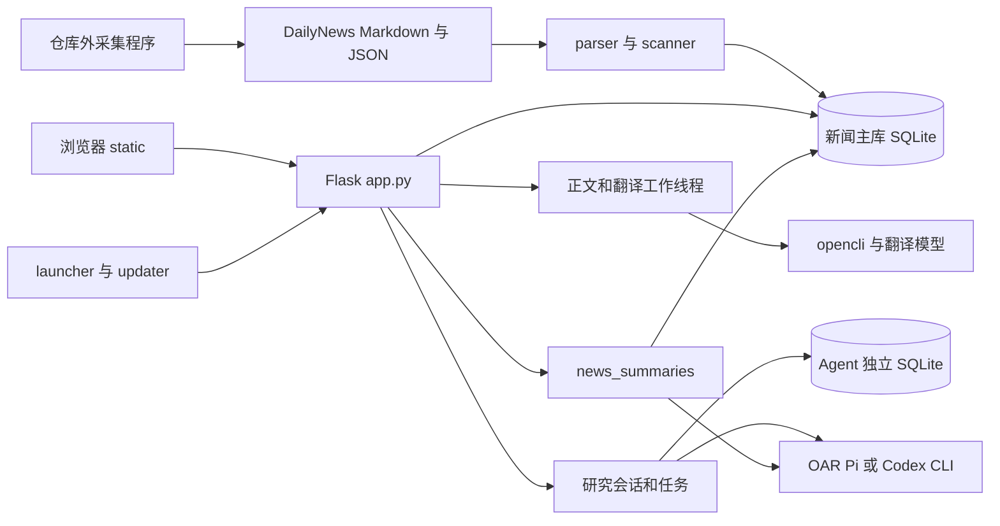

# 架构与接口说明

应用由同一个 Flask 进程提供静态页面和 JSON API，SQLite 保存本地业务数据。正文抓取、翻译和研究任务依赖进程内线程及本机 CLI。当前启动方式面向单实例；改为多进程 WSGI 或容器集群前，需要重新设计任务领取、进程恢复、会话及更新控制。

## 组件关系

## 模块职责与修改入口

| 位置 | 职责 | 修改时关联检查 |
| --- | --- | --- |
| `app.py` | Flask 路由、SQL、业务状态、后台线程、运行时迁移 | 文件约 1.2 万行；先定位处理函数及对应测试 |
| `parser.py` / `scanner.py` | Markdown、sidecar 解析；文件签名、稳定 ID 和增量入库 | 不能破坏状态关联和原文件兼容 |
| `schema.sql` | 新闻库基础表、索引及触发器 | 不是全部数据库结构，另有运行时 DDL |
| `settings.py` / `secret_store.py` | 路径优先级、配置规范化、macOS Keychain | 不读取并发布真实密钥；配置更换路径需重启 |
| `llm_client.py` | 翻译、精读、摘要及兼容模型调用 | 与新闻研究 Agent 的配置通道区分 |
| `oar_client.py` / `scripts/oar_bridge.mjs` | Python 与 Node 的私有桥接、Pi/OAR 运行和资源继承 | stdin JSON / stdout 事件；终止时清理子进程组 |
| `codex_client.py` | Codex CLI 命令、事件流、会话映射 | 本机凭据；read-only 沙盒及不请求审批配置 |
| `model_catalogs.py` / `connection_tests.py` | 模型目录缓存、草稿连接测试 | 失败保留有效目录；不覆盖其他设置草稿 |
| `model_apis.py` | HTTP 模型服务注册、配置规范化及原生测试协议 | DeepSeek Chat Completions 与 Jev System One 各自解析响应；密钥仍由 `secret_store.py` 管理 |
| `news_summary_selection.py` / `news_summaries.py` | 选择范围、预览快照、任务执行、验证、事务归档 | 成功保存报告和批量标读必须原子完成 |
| `daily_briefings.py` | 旧日报文件解析 | 保留兼容 API |
| `launcher.py` / `updater.py` | 单实例服务管理、健康检查、版本更新与恢复 | Git 工作区、更新源、版本和实例校验 |
| `static/app.js` / `static/item-state.js` / `static/read-later.js` | 列表、集合、阅读器与状态呈现 | 计数竞态、滚动标读、稍后再看状态机 |
| `static/agent-panel.js` / `static/summary-panel.js` | 单篇研究与新闻总结界面 | SSE、轮询、任务恢复、过期请求 |
| `static/research-notes.js` / `static/reader-highlights.js` | 新闻评论、引用与高亮 | 文字偏移、重复文本、非 BMP 字符 |
| `static/standalone-ideas.js` / `frontend/idea-markdown-editor.js` | 独立想法及 Markdown 编辑器源文件 | 草稿、撤销、异步保存；变更编辑器后重新构建 |
| `static/vendor/idea-markdown-editor.js` | 已提交的编辑器构建产物 | 用 `npm run build:idea-editor` 生成，不手工改压缩代码 |
| `static/settings-panel.js` / `static/update-panel.js` | 设置草稿、保存、模型及更新状态 | 防止旧响应覆盖新草稿 |
| `static/upstream-errors.js` / `static/error_ui.js` | 上游报错浏览及错误反馈 | 区分采集异常、API 错误、模型错误 |
| `static/tokens.css` / `static/style.css` / `static/design-tokens.json` | 主题与布局 | CSS Token 和 JSON 映射保持一致 |
| `static/brand/` / `docs/brand-assets.md` | 标志、字标、favicon 及来源说明 | 保留轮廓字标和第三方许可文件 |

## 数据结构与迁移入口

| 数据域 | 主要表 | 主键或关联方式 |
| --- | --- | --- |
| 新闻索引 | `source_files`、`items` | 源文件相对路径；稳定新闻 ID |
| 用户状态 | `item_state`、`reading_checkpoints` | item_id；阅读检查点按 scope |
| 抓取和精读 | `detail_jobs`、`article_details`、`ai_jobs`、`article_ai` | 主要按 URL |
| 新闻想法 | `article_notes`、`article_note_entries`、`article_note_metadata` | URL；元数据按 note_id，删除触发器同步清理 |
| 高亮及独立想法 | `article_highlights`、`standalone_ideas` | 高亮含 URL、正文类型、哈希、偏移和上下文 |
| 新闻总结 | `news_summary_meta`、`news_summary_previews`、`news_summary_jobs`、`news_summaries` | request_id、database_token、不可变快照和来源引用 |
| 媒体 | `media_cache` 与缓存目录 | URL、cache_key、相对文件路径 |
| 历史功能 | `market_*`、`article_market_tags`、`news_reminders`、`tracked_*`、`review_*` | 保留旧业务关系和数据 |
| 独立 Agent 库 | `agent_sessions`、`agent_jobs`、`agent_messages` | 会话、任务和消息 ID；与新闻 item_id 关联 |

主库的基础 DDL 在 `schema.sql`；`scanner.apply_schema` 和 `app.ensure_db` 执行旧库兼容，`news_summaries.SCHEMA` 创建总结表。Agent 表由 `app.ensure_agent_db` 创建。当前没有统一的版本化迁移框架，不能只运行 `schema.sql` 就认定完成初始化。

带 URL 的新闻 ID 为 `sha256(date + "|" + url)`；无 URL 时退回日期、来源、标题组合。修改 ID 算法、URL 规范化或解析日期可能使旧状态失去关联。重新索引会更新索引内容，变更文件中消失的条目可被删除；`full=true` 会先清空新闻索引和源文件记录，因此不是恢复个人状态的方式。

## 核心执行流程

**新闻导入**：页面请求增量 `/api/reindex` → 递归找 Markdown 入口 → 有效 sidecar 优先，否则 Markdown → 按文件签名跳过未变输入 → 稳定 ID upsert → 更新索引和统计。应用不写回原采集文件。

**正文与翻译**：加入稍后再看 → `detail_jobs` → 后台调用特定 opencli 命令 → 保存正文 → 后续精读任务写入 `article_ai`。正文临时错误每轮最多尝试 3 次，间隔 5 秒和 15 秒；登录受限、空正文和格式错误不反复自动请求。后台恢复依赖任务状态及进程信息。

**研究 Agent**：有可用正文 → 建立会话和快照 → 提交任务返回 202 → 工作线程运行 Pi/OAR 或 Codex → SSE 事件或轮询更新 → 成功、失败、停止或中断。默认 2 个 Agent 工作线程、单任务 300 秒硬超时；会话 TTL 为 72 小时，可选 24 小时，运行任务不被 TTL 清理。新会话和空会话采用当前配置，有对话后固定首次执行配置。

**新闻总结**：scope 估算 → prepare 锁定快照 → create 确认 → 后台生成与引用验证 → 同一事务保存报告及锁定集合已读状态。每个数据库只允许一个 active 总结；配置、数据库或原材料改变会阻止旧任务提交。

## 常用接口契约

以下是维护入口摘要，全部显式路由见 [API 索引](api-routes.md)。参数和错误边界以处理函数及 `tests/test_api.py`、相应专项测试为准；仓库未提供 OpenAPI 规范。

| 请求 | 请求或返回重点 |
| --- | --- |
| `GET /api/version` | 应用版本和 Git/运行实例信息；健康检查使用此接口 |
| `POST /api/reindex` | JSON `{"full": false}`；返回扫描、变更、入库和解析方式统计 |
| `GET /api/news` | `collection=feed/read_later/important/favorites/notes`；`read_filter`、`source_filter`、`q`、`sort_order=default/reverse`、`page`、`per`；返回 items、total、has_more、next_cursor |
| `GET /api/search` / `/api/sources` / `/api/nav-summary` | 搜索、信源及导航统计；参数与新闻接口不应假定完全相同 |
| `PATCH /api/news/<item_id>/state` | `read`、`important`、`read_later`、`favorite` 均为布尔；看完使用 `{"read_later":false,"read_later_done":true}` |
| `POST /api/news/mark-read-by-ids` | `{"item_ids":["..."]}`；用于已加载新闻标读 |
| `POST /api/news/mark-all-read` | 传来源、搜索和集合条件；由服务端覆盖匹配记录，不限当前页 |
| `POST /api/news/clear-favorites` | 清除全部收藏，无筛选范围限制 |
| `GET /api/news/<item_id>/detail` | 正文、精读、想法和抓取状态；重试走 `/detail/retry` |
| `POST /api/news/<item_id>/notes` | `note`；可选 `quote={text,source,paragraph}`，source 为 original/translated/conclusion/points；删除走 `/notes/<note_id>` |
| `POST /api/standalone-ideas` | `{"title":"可选标题","note":"Markdown 正文"}`；返回 idea；更新使用 PATCH，同样必须传 note |
| `POST /api/news/<item_id>/agent/session` | 可选 `new_session` 或 `reset`；返回会话、消息、任务 |
| `POST /api/news/<item_id>/agent/jobs` | `question`、`quote_text`、`quote_source`、可选 session_id；引用来源可用 selection；问题和引用各最多 4000 字符；返回 202 仅表示接受任务 |
| `GET /api/news/<item_id>/agent/jobs/<job_id>/stream` | SSE；另有 GET 状态、POST stop/retry |
| `GET/POST /api/news-summaries/scope` | 计算范围，不锁定材料、不调用模型 |
| `POST /api/news-summaries/prepare` | 使用 request_id 和当前 database_token 建立预览；token 从 scope 或列表取得；返回 preview id 和范围 |
| `POST /api/news-summaries` | 原 request_id、preview_id、database_token；返回 202 和 job |
| `GET /api/news-summaries/jobs/<job_id>` | 轮询；取消用 POST 同路径 `/cancel` 并传 database_token |
| `GET/PUT /api/settings` | 获取和保存配置；UI 连接测试使用当前草稿；路径环境变量优先 |
| `POST /api/settings/apis/<provider>/models`、`/test` | `deepseek`／`jev` 共用模型获取与测试入口；测试传 `{model}`，不保存配置；旧 `/translation/models`、`/translation/test` 路径继续可用 |
| `PUT/DELETE /api/settings/secrets/<provider>` | 按服务保存／删除钥匙串密钥；Jev 使用 `TYPESAFE_API_KEY`，环境变量优先；响应仅返回掩码 |
| `GET /api/update/check` / `/api/update/status` | 检查远端稳定标签及读取进度；实际应用更新用 POST `/api/update/apply` |

大多数错误返回 `ok:false` 和错误码，但成功响应并未完全统一，例如新闻列表正常返回没有 `ok`。前端应结合 HTTP 状态和接口契约判断，不能把缺少 `ok` 统一判为失败。分页时应透传服务端游标，避免标读导致集合缩小后使用 offset 漏项。
