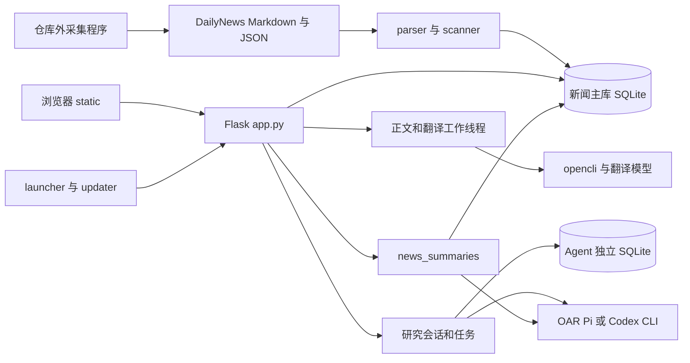

# 架构与接口说明

应用由同一个 Flask 进程提供静态页面和 JSON API，SQLite 保存本地业务数据。正文抓取、翻译和研究任务依赖进程内线程及本机 CLI。当前启动方式面向单实例；改为多进程 WSGI 或容器集群前，需要重新设计任务领取、进程恢复、会话及更新控制。

## 组件关系

### v0.2.1 新闻分类

- `news_classification.py` 负责原生 Jev 请求、响应校验、确定性主分类选择及持久队列；`classification/rules.json` 保存第二轮评估后的规则（`news-category-v2`）。主题 Choice 与中国主体 Noul 同次请求，只有主题是 AI 时优先选 AI，否则中国概率严格大于 0.5 归中国，其余按主题选择。
- `item_classifications` 以 `item_id` 为主键，保存标题原文／SHA-256、规则版本、类别、模型、概率、复核标记、token 用量、任务状态与租约。与投资标签和阅读状态独立；不设置删除级联，以便全量索引复用相同 ID 和标题的分类。
- `ensure_db()` 首次补齐历史任务；`scanner.reindex()` 结束时只排队新增、标题变化或规则过期的记录并清理已删除新闻。索引事务内不调用外部服务。升级规则需显式修改规则版本；只改模型配置不会使已完成结果全部重跑，实际使用的模型逐条留存。
- `main()` 按 `classification.concurrency` 启动后台分类线程（默认 8，范围 1–32），复用 API 管理的 Jev 密钥／模型。设置保存后热更新共享并发门限，增加上限时按需增建线程，减少时允许已有请求完成。SQLite 写事务领取任务，180 秒租约允许崩溃恢复；完成时核验租约令牌、标题指纹、规则与当前标题，拒绝过期结果。网络及一般服务错误按 5／30／120 秒退避，最多 4 次；凭据／模型配置错误暂停该配置，不将失败归入其他。
- `classification.enabled` 为自动分类总开关（默认 true），服务初始化及设置保存时加载。关闭与任务领取共用锁，关闭后不领取新的分类任务、不为主分类发起新的模型调用（主题归属不受此开关影响），已领取请求允许完成；索引仍维护队列，结果和筛选保留，重新开启后继续处理。关闭时重试接口返回409 `classification_disabled`，状态接口返回 `enabled=false`，前端隐藏圆环并降为空闲轮询。旧 Jev 并发与未读配置在读取时迁入 `classification`，新对象字段优先，后续保存仅在 `api_models.jev` 保留模型；兼容旧客户端传入分类字段，API 模型单独保存不重置分类开关。
- `AdaptiveConcurrency` 对当前进程的全部分类线程共享有效并发和冷却。429／529 使有效并发减半，按请求代次避免同批响应重复降速；指数等待 5–300 秒并遵守更长的 `Retry-After`（秒数或 HTTP 日期）。冷却后稳定至少 30 秒且累计 `max(8, 有效并发×2)` 次连续成功，每次增加 1，最多恢复至配置上限；限流前发出的请求即使迟到成功也不能触发恢复。限流任务保留 pending、撤销本次失败次数并保存下次执行时间；手动重试和调整并发不清除共享冷却。调速状态在进程内维护，重启按保存的上限开始，已有分类和队列重试时间继续保留；多进程部署需另做跨进程限速。
- `classification.unread_only` 是布尔开关（默认 false），保存后即时更新服务，启动时恢复。开启时 `claim`、`status`、`retry_failed` 使用同一未读条件：不存在 `item_state.read_at IS NOT NULL` 的状态记录；无状态记录也视为未读。领取任务与设置切换串行，模型请求在锁外执行；切换前已领取的请求继续完成。索引仍维护全部新闻的队列，已读待处理记录不消耗请求或尝试次数，改为未读或关闭开关后自动恢复资格。已有结果不清除，分类筛选不受开关影响；进度接口返回 `unread_only` 及当前范围的计数。
- `classification_progress_batch` 与 `classification_progress_items` 仅保存当前批次及其新闻标题指纹／规则版本。首次读取状态或领取任务时，在写事务内收录当前可执行且未完成的新闻；本批仍有待处理、在途或失败任务时合入新增任务，已结束后出现新任务才清空成员并生成新批ID。刷新、服务重启和重试保留批次；仅未读范围变化重新建立，已完成成员不因标读退出。已删除或标题／规则不符的成员不计入，改写任务重新收录。状态查询的短写事务用于持久化批次发现，模型请求仍在事务外。
- `GET /api/news/classification` 返回独立的 `batch` 本次进度、全库 `coverage`、原有队列进度和 `throttle`（配置／有效并发、在途数、限流状态、剩余冷却秒数）；`POST /api/news/classification/retry` 重排失败任务并恢复配置错误导致的暂停，保留限流冷却。接口不返回密钥或上游错误正文。无密钥时等待，阅读和索引仍正常。
- `static/classification-progress.js` 独立维护顶栏确定性圆环与悬停卡片。所有集合中有 pending／running 时每 2 秒读取进度，空闲每 30 秒探测；页面隐藏暂停、回到前台或刷新索引时立即读取，限制单个在途请求，失败时保留上次计数并标注。圆环按 batch.done／batch.total 绘制，pending／running／failed 均为零时连同浮层隐藏；失败不伪装为成功。分类进度刷新不重载新闻列表或修改阅读位置。
- `/api/news`、`/api/search`、`/api/news/mark-all-read` 接受 `category=all|china|ai|politics|economy|business|science|other`；未知类别返回 400。服务端先筛选当前标题和规则下的完成结果，再做计数、日期分组、分页或批量操作。新闻序列化增加 `category`、`category_label`、`classification_status`。未完成记录只出现在全部，侧栏全局计数不跟随分类。
- 新闻列表复用 `/api/news`、`/api/search` 的 `date_counts` 生成日期分组。`count_only=1` 可追加 `date_counts=1` 取得同一筛选范围的每日完整数量；不传时保持仅返回总数。未知日期归入 `unknown`。主筛选统计使用 `category=all`，日期统计保留当前分类；前端以请求序号、范围及写入版本隔离过期响应，乐观标读同步更新当日数量。

### 原有数据流

## 模块职责与修改入口

| 位置 | 职责 | 修改时关联检查 |
| --- | --- | --- |
| `app.py` | Flask 路由、SQL、业务状态、后台线程、运行时迁移 | 文件约 1.2 万行；先定位处理函数及对应测试 |
| `parser.py` / `scanner.py` | Markdown、sidecar 解析；文件签名、稳定 ID 和增量入库 | 不能破坏状态关联和原文件兼容 |
| `schema.sql` | 新闻库基础表、索引及触发器 | 不是全部数据库结构，另有运行时 DDL |
| `settings.py` / `secret_store.py` | 路径优先级、配置规范化、macOS Keychain | 不读取并发布真实密钥；配置更换路径需重启 |
| `llm_client.py` | 翻译、精读、摘要及兼容模型调用 | 与新闻研究 Agent 的配置通道区分 |
| `oar_client.py` / `scripts/oar_bridge.mjs` | Python 与 Node 的私有桥接、Pi/OAR 运行和资源继承 | stdin JSON / stdout 事件；终止时清理子进程组 |
| `codex_client.py` | Codex CLI 命令、事件流、会话映射 | 本机凭据；read-only 沙盒及不请求审批配置 |
| `model_catalogs.py` / `connection_tests.py` | 模型目录缓存、草稿连接测试 | 失败保留有效目录；不覆盖其他设置草稿 |
| `model_apis.py` | HTTP 模型服务注册、配置规范化及原生测试协议 | DeepSeek Chat Completions 与 Jev System One 各自解析响应；密钥仍由 `secret_store.py` 管理 |
| `news_summary_selection.py` / `news_summaries.py` | 选择范围、预览快照、任务执行、验证、事务归档 | 成功保存报告和批量标读必须原子完成 |
| `daily_briefings.py` | 旧日报文件解析 | 保留兼容 API |
| `launcher.py` / `updater.py` | 单实例服务管理、健康检查、版本更新与恢复 | Git 工作区、更新源、版本和实例校验 |
| `static/app.js` / `static/item-state.js` / `static/read-later.js` | 列表、集合、阅读器与状态呈现 | 计数竞态、滚动标读、稍后再看状态机 |
| `static/agent-panel.js` / `static/summary-panel.js` | 单篇研究与新闻总结界面 | SSE、轮询、任务恢复、过期请求 |
| `static/research-notes.js` / `static/reader-highlights.js` | 新闻评论、引用与高亮 | 文字偏移、重复文本、非 BMP 字符 |
| `static/standalone-ideas.js` / `frontend/idea-markdown-editor.js` | 独立想法及 Markdown 编辑器源文件 | 草稿、撤销、异步保存；变更编辑器后重新构建 |
| `static/vendor/idea-markdown-editor.js` | 已提交的编辑器构建产物 | 用 `npm run build:idea-editor` 生成，不手工改压缩代码 |
| `static/keyboard-shortcuts.js` | 快捷键默认表、组合键规范化、冲突校验、本地持久化与提示同步 | 与设置草稿、新闻／想法／总结按键处理一起回归；不写服务器配置 |
| `static/settings-panel.js` / `static/update-panel.js` | 设置草稿、保存、模型及更新状态 | 防止旧响应覆盖新草稿 |
| `static/upstream-errors.js` / `static/error_ui.js` | 上游报错浏览及错误反馈 | 区分采集异常、API 错误、模型错误 |
| `static/tokens.css` / `static/style.css` / `static/design-tokens.json` | 主题与布局 | CSS Token 和 JSON 映射保持一致 |
| `static/brand/` / `docs/brand-assets.md` | 标志、字标、favicon 及来源说明 | 保留轮廓字标和第三方许可文件 |

## 数据结构与迁移入口

| 数据域 | 主要表 | 主键或关联方式 |
| --- | --- | --- |
| 新闻索引 | `source_files`、`items` | 源文件相对路径；稳定新闻 ID |
| 用户状态 | `item_state`、`reading_checkpoints` | item_id；阅读检查点按 scope |
| 抓取和精读 | `detail_jobs`、`article_details`、`ai_jobs`、`article_ai` | 主要按 URL |
| 新闻想法 | `article_notes`、`article_note_entries`、`article_note_metadata` | URL；元数据按 note_id，删除触发器同步清理 |
| 高亮及独立想法 | `article_highlights`、`standalone_ideas` | 高亮含 URL、正文类型、哈希、偏移和上下文 |
| 新闻总结 | `news_summary_meta`、`news_summary_previews`、`news_summary_jobs`、`news_summaries` | request_id、database_token、不可变快照和来源引用 |
| 媒体 | `media_cache` 与缓存目录 | URL、cache_key、相对文件路径 |
| 主题追踪 | `event_topics`、`topic_ingestions`、`topic_checks`、`topic_jobs`、`topic_nodes`、`topic_node_items` | 首次入库序号、主题／新闻独立归属、任务租约与增量节点 |
| 历史功能 | `market_*`、`article_market_tags`、`news_reminders`、`tracked_*`、`review_*` | 保留旧业务关系和数据 |
| 独立 Agent 库 | `agent_sessions`、`agent_jobs`、`agent_messages` | 会话、任务和消息 ID；与新闻 item_id 关联 |

主库的基础 DDL 在 `schema.sql`；`scanner.apply_schema` 和 `app.ensure_db` 执行旧库兼容，`news_summaries.SCHEMA` 创建总结表，`topic_tracking.SCHEMA` 创建主题追踪表。Agent 表由 `app.ensure_agent_db` 创建。当前没有统一的版本化迁移框架，不能只运行 `schema.sql` 就认定完成初始化。

带 URL 的新闻 ID 为 `sha256(date + "|" + url)`；无 URL 时退回日期、来源、标题组合。修改 ID 算法、URL 规范化或解析日期可能使旧状态失去关联。重新索引会更新索引内容，变更文件中消失的条目可被删除；`full=true` 会先清空新闻索引和源文件记录，因此不是恢复个人状态的方式。

## 核心执行流程

**新闻导入**：页面请求增量 `/api/reindex` → 递归找 Markdown 入口 → 有效 sidecar 优先，否则 Markdown → 按文件签名跳过未变输入 → 稳定 ID upsert → 更新索引和统计。应用不写回原采集文件。

**正文与翻译**：加入稍后再看 → `detail_jobs` → 后台调用特定 opencli 命令 → 保存正文 → 后续精读任务写入 `article_ai`。正文临时错误每轮最多尝试 3 次，间隔 5 秒和 15 秒；登录受限、空正文和格式错误不反复自动请求。后台恢复依赖任务状态及进程信息。

**研究 Agent**：有新闻标题和链接（正文可选）→ 建立会话和快照 → 提交任务返回 202 → 工作线程运行 Pi/OAR 或 Codex → SSE 事件或轮询更新 → 成功、失败、停止或中断。默认 2 个 Agent 工作线程、单任务 300 秒硬超时；会话 TTL 为 72 小时，可选 24 小时，运行任务不被 TTL 清理。新会话和空会话采用当前配置，有对话后固定首次执行配置。首轮的 `build_agent_prompt` 仅组织新闻元数据、正文／无全文状态、问题和引用；旧同步入口复用此格式。正常原生续接的 `build_agent_resume_prompt` 只返回新问题及可选引用，不再注入应用行为规则或重复新闻。Pi 桥接仍保留完整资料和可见历史作为迁移／重建备用输入，只有无法正常续接而确需重建时使用；正常续聊由原生运行时保留上下文。新闻对话不设置 `research_budget_ms`／`max_tool_calls`，避免软预算通过 steer 插入回答要求；硬超时、取消、模型绑定和原生权限继续生效。旧会话历史中的既有规则不改写。

**Agent 归档**：`POST /api/news/<item_id>/chat/archive` 提供 `agent_session_id` 时，在读事务中核验新闻与会话归属、检查未结束任务并读取已存消息，忽略客户端消息副本。读取 201 条以检测 200 条上限，超限拒绝而非沿用页面截断结果；空助手占位不作为回答，单条 20000 字符、引用 4000 字符超限均不调用模型。没有持久会话 ID 的旧客户端仍校验并使用提交的消息。归档在独立临时模型会话中综合全部主要主题，使用原会话模型配置，不设最低字数或固定压缩比例，一句话足够就只写一句。正文上限为 `min(300, 原对话正文字符数)`：逐条正文去除首尾空白后按 Unicode 字符计数，含内部空白、标点和链接；引用、新闻元数据及提示模板不计入原对话长度。Pi／Codex 共用长度预算与提示词，超长时根据完整对话重新压缩一次；再次超长返回 `invalid_archive_summary`，不截断保存。完全没有实质内容时模型输出内部标记 `[[NO_ARCHIVE_CONTENT]]`，转为空结果并返回 `empty_archive_summary`，界面提示没有可归档的实质内容。仅合规结果追加想法及来源会话 ID，不改原对话或历史归档；重试失败、空结果及超长均不改既有想法。

**新闻总结**：scope 估算 → prepare 锁定快照 → create 确认 → 后台生成与引用验证 → 同一事务保存报告及锁定集合已读状态。每个数据库只允许一个 active 总结；配置、数据库或原材料改变会阻止旧任务提交。

## 主题追踪执行约定（v0.2.5）

`topic_tracking.py` 独立管理事件档案，`static/topic-panel.js` 管理列表、创建、双时间线和阅读器返回；不复用旧版关键词跟踪的 `tracked_*` 表及接口。

1. 创建请求携带 `request_id`，联网生成定义及横向收录规则后进入 draft。初稿和确认邀请保存到 `topic_definition_messages`；draft阶段通过messages接口多轮协商，discuss任务复用全局Agent配置，输入当前定义、初始来源和最近40条对话，必要时可联网核实（不强制每轮检索）。每轮问题含幂等request_id及rules_revision，回复可仅解释或原子更新完整定义；修订和消息均持久化，重试不重复问题，旧draft可补齐初始对话。每轮收取问题及完成回复均递增rules_revision；活动或失败的回复阻止initialize，确认携带最新版本以拒绝旧稿。聊天中的同意不改变状态，只有用户点击确认按钮提交initialize才开始历史研究；新主题拒绝monthly模式。联网整理历史成功时，在同一事务内写入历史节点并捕获 `topic_ingestions` 的最大序号，再进入 ready。
2. `topic_ingestions` 在迁移时登记既有 items，之后随索引 upsert 登记首次入库，永久保留稳定ID的序号。完整重建索引、源文件删除再出现都不能把旧ID误判为新入库。只有 ready 主题边界之后的新闻排入 `topic_checks`；不向模型传历史新闻库，初始化期间的新闻不补匹配。
3. Jev 的现有 worker 优先领取新主题判断，再合并同一新闻符合范围的主分类请求；主分类仍只看标题，独立 `tracked_<id>` Choice 使用标题和已有摘要。每个主题分别属于／不属于／信息不足，一条新闻可多归属；信息不足不纳入且不抓正文。分类开关、unread_only及阅读状态仅约束主分类；并发门和限流与主题共享。
4. 每个判断保存标题＋摘要指纹、模型和概率；租约180秒，普通错误最多4次、5／30／120秒退避，凭据和限流错误不消耗次数。更改标题／摘要会重新排队；回写核验当前内容、主题版本和租约，数据库切换后旧响应不会写进新库。
5. 新主题仅使用 events；匹配完成至少3秒后安排 milestone 任务，由现有 Jev worker 共享并发／限流执行，不读取 Agent 配置。每个主题最多一个活动任务，每次判断一条新闻，下一条可看到刚新增的节点。输入为标题／摘要、该新闻的规则快照及最近80个非month节点的ID／日期／标题；Choice 返回新增节点、某个已有节点、不收录或信息不足。新节点原样使用标题／摘要及报道日期；已有节点仅增加新闻关联，其余结果保留纵向新闻。返回结果校验选项、概率、租约、主题生命周期版本及内容指纹，拒绝过期回写。milestone复用持久任务表，租约180秒、普通错误最多4次、5／30／120秒退避，限流和配置错误不消耗次数；失败显示在主题详情并可重试。旧monthly主题仍由Agent按同一规则快照分批（最多60条）更新同月节点，不联网、不抓正文。
6. 定义和初始化复用当前「模型与 Agent」配置，Codex只接受原生web_search研究事件；Pi需要可辨识的web/browser/tavily/brave/exa/firecrawl等联网工具。仅工具发现或本地工具不算完成搜索。所有初始节点要求实际来源URL，来源仅内部留存。后续总结明确禁用Codex搜索，并拒绝任何工具事件。
7. 模型请求不持有写事务；Agent研究任务持久化配置和输入快照，租约1020秒，子进程最长900秒。失败或租约到期可在主题详情重试；参数不完整、来源变化及非法模型引用均不保存部分结果。最多32个未归档主题（含创建中），删除主题不改变 items/item_state 或首次入库账本。
8. 主题详情分页默认40条、最多400条；`seen` 只更新主题待查看标记，以前端实际取得的 `observed_at` 为截止，不标读新闻。详情在读取前捕获截止时间并开启读事务，避免响应读取期间的新更新被确认。`topic_activity` 统一比较新闻匹配时间、重要进展更新时间与 seen_at，`/api/nav-summary.topics_unseen` 按有更新的未归档ready主题去重计数，列表同时返回 has_new_progress / has_updates。主题ISO时间保留微秒，避免同一秒内的新进展漏报；前端按实际可见主题和活动版本确认，新闻正文、筛选及编辑页面不确认。匹配／研究后台在 `main()` 启动；创建或重试研究也会唤醒工作线程。
9. `event_topics.archived_at` 独立于创建状态，由 `scanner.apply_schema` 为已有主题库补列。归档仅允许ready主题；事务内递增revision、撤销未完成的匹配／整理租约并冻结现有资料，在途模型结果不得写回。归档期间不入队，也不能重试；恢复递增revision并把cutoff_seq设为当前首次入库账本最大值，不补收历史或归档期间新闻。重复设置同一状态不改变边界；已归档主题不占32个活动名额。

10. 初始历史通常5–10个、最多12个阶段里程碑，生成的历史正文上限600字符，模型提示通常不超过160字；Jev后续入选节点直接保留新闻标题和已有摘要。用户可触发refine任务，仅使用现有非month节点（最多300个／160000字符）离线合并，输出最多12组；所有旧节点id必须恰好覆盖一次，日期来自组内旧节点。全量校验后先存入 `topic_refinements` 预览快照，任务状态为preview，现有节点不变。用户通过版本ID显式apply后原子替换，保留来源、新闻映射、月度节点及阅读状态，任务才改为done并更新时间。apply对比原始节点、来源和关联快照及主题生命周期版本，旧预览返回冲突；discard不占用冷却。restore只恢复最近应用的版本，保留之后新增的节点与报道；原合并节点获得的新报道留在原合并节点，原有报道恢复精简前关联，避免凭空推测新报道归属。apply／discard／restore幂等，restore不修改成功应用时间。精简入口和retry在事务内检查上次成功应用refine任务的updated_at，必须满一个自然月；月末日期截到下月最后一天同一时刻。详情返回冷却状态供前端隐藏按钮，失败不记成功时间，不新增主题表时间字段，既有成功任务也受限制。归档／删除取消在途回写；失败保留原时间线，重试成功前不启动新整理任务，避免失败状态被掩盖。

11. ready主题可通过definition接口编辑名称、定义、范围及horizontal_rule；不修改历史起点或已有模式。rules_revision用于乐观并发校验，与初始化／归档用的revision分开。保存前将已入库但未排队的新闻按旧规则排队，并补齐旧记录快照；topic_checks.rules_json保存首次排队时的定义／规则版本，之后标题或摘要变更也保留此快照。编辑不改归属、节点、cutoff或生命周期版本，在途结果可按旧规则完成。保存后首次入库的新新闻使用新规则；归档期间编辑在恢复后的新新闻生效。迁移补齐默认横向规则，并将旧events尚未完成的update任务转换为Jev milestone任务，既有节点与新闻保留。

自动化验证用隔离数据库和确定性模型替身，见 `tests/test_topic_tracking.py`；真实外部模型结果质量与搜索能力仍需在用户实际配置下验证。Jev协议依据：[官方SDK类型](https://github.com/typesafe-ai/typesafe-sdk-js/blob/main/src/types.ts)。

## 常用接口契约

以下是维护入口摘要，全部显式路由见 [API 索引](api-routes.md)。参数和错误边界以处理函数及 `tests/test_api.py`、相应专项测试为准；仓库未提供 OpenAPI 规范。

| 请求 | 请求或返回重点 |
| --- | --- |
| `GET /api/version` | 应用版本和 Git/运行实例信息；健康检查使用此接口 |
| `POST /api/reindex` | JSON `{"full": false}`；返回扫描、变更、入库和解析方式统计 |
| `GET /api/news` | `collection=feed/read_later/important/favorites/notes`；`read_filter`、`source_filter`、`q`、`sort_order=default/reverse`、`page`、`per`；返回 items、total、has_more、next_cursor |
| `GET /api/search` / `/api/sources` / `/api/nav-summary` | 搜索、信源及导航统计；参数与新闻接口不应假定完全相同 |
| `PATCH /api/news/<item_id>/state` | `read`、`important`、`read_later`、`favorite` 均为布尔；看完使用 `{"read_later":false,"read_later_done":true}` |
| `POST /api/news/mark-read-by-ids` | `{"item_ids":["..."]}`；用于已加载新闻标读 |
| `POST /api/news/mark-all-read` | 传来源、搜索和集合条件；由服务端覆盖匹配记录，不限当前页 |
| `POST /api/news/clear-favorites` | 清除全部收藏，无筛选范围限制 |
| `GET /api/news/<item_id>/detail` | 正文、精读、想法和抓取状态；重试走 `/detail/retry` |
| `POST /api/news/<item_id>/notes` | `note`；可选 `quote={text,source,paragraph}`，source 为 original/translated/conclusion/points；删除走 `/notes/<note_id>` |
| `POST /api/standalone-ideas` | `{"title":"可选标题","note":"Markdown 正文"}`；返回 idea；更新使用 PATCH，同样必须传 note |
| `POST /api/news/<item_id>/agent/session` | 可选 `new_session` 或 `reset`；返回会话、消息、任务 |
| `POST /api/news/<item_id>/agent/jobs` | `question`、`quote_text`、`quote_source`、可选 session_id；引用来源可用 selection；问题和引用各最多 4000 字符；返回 202 仅表示接受任务 |
| `GET /api/news/<item_id>/agent/jobs/<job_id>/stream` | SSE；另有 GET 状态、POST stop/retry |
| `GET/POST /api/news-summaries/scope` | 计算范围，不锁定材料、不调用模型 |
| `POST /api/news-summaries/prepare` | 使用 request_id 和当前 database_token 建立预览；token 从 scope 或列表取得；返回 preview id 和范围 |
| `POST /api/news-summaries` | 原 request_id、preview_id、database_token；返回 202 和 job |
| `GET /api/news-summaries/jobs/<job_id>` | 轮询；取消用 POST 同路径 `/cancel` 并传 database_token |
| `GET/PUT /api/settings` | 获取和保存配置；UI 连接测试使用当前草稿；路径环境变量优先 |
| `POST /api/settings/apis/<provider>/models`、`/test` | `deepseek`／`jev` 共用模型获取与测试入口；测试传 `{model}`，不保存配置；旧 `/translation/models`、`/translation/test` 路径继续可用 |
| `PUT/DELETE /api/settings/secrets/<provider>` | 按服务保存／删除钥匙串密钥；Jev 使用 `TYPESAFE_API_KEY`，环境变量优先；响应仅返回掩码 |
| `GET /api/update/check` / `/api/update/status` | 检查远端稳定标签及读取进度；实际应用更新用 POST `/api/update/apply` |

大多数错误返回 `ok:false` 和错误码，但成功响应并未完全统一，例如新闻列表正常返回没有 `ok`。前端应结合 HTTP 状态和接口契约判断，不能把缺少 `ok` 统一判为失败。分页时应透传服务端游标，避免标读导致集合缩小后使用 offset 漏项。
