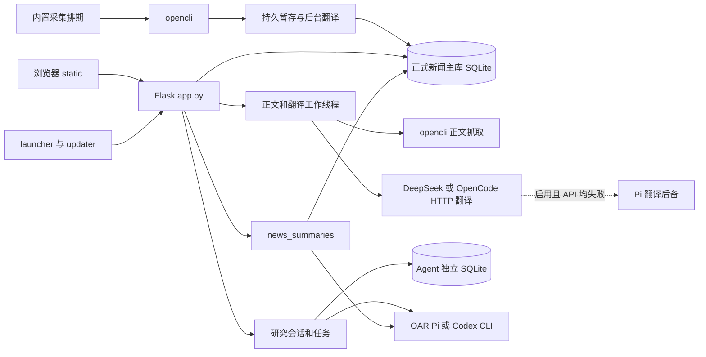

# 架构与接口说明

2026-11-08：采集架构已改为应用内 opencli → 持久暂存 → 翻译 → 正式新闻库，详见[当前采集架构与接口](../native-collection.md)。下文涉及扫描和文件导入的历史记录已退役。

应用由同一个 Flask 进程提供静态页面和 JSON API，SQLite 保存本地业务数据。正文抓取、翻译和研究任务依赖进程内线程及本机 CLI。当前启动方式面向单实例；改为多进程 WSGI 或容器集群前，需要重新设计任务领取、进程恢复、会话及更新控制。

## 组件关系

### 按功能配置模型

- 设置页在「模型与 Agent」中以始终展开的共享分区分别编辑 Chat、主题追踪、新闻总结、日报（早／午／晚）及周报／月报。Chat 保持 `agent.runtime / agent.codex / llm.pi_chat` 的原有存储与 API 契约；主题、总结保存在 `feature_models.topics / summaries`；早午晚报共用 `feature_models.reports`，周报与月报共用 `feature_models.reports_periodic`，没有自定义报告模型配置，每项含 `runtime`、`codex`、`pi`。各功能分别保留两种 Runtime 的选择，切换不清空另一种配置。
- `settings.feature_model_config()` 返回独立副本。旧文件缺少主题、总结或报告总配置时从原 Chat 配置填充；缺少周月报组配置时从原 `reports` 独立复制，明确设置优先；首次保存固化这些初值，以后改变 Chat 或旧客户端省略 `feature_models` 均不覆盖其他功能。`normalize_feature_models()` 校验 Runtime、模型字段和 Codex 配置，设置接口对变化的 Codex 配置核验推理强度；模型目录按 Runtime、服务商和 Profile 缓存。
- 新闻总结通过 `news_summaries.capture_config()` 读取 summaries；主题创建、研究、精简及手动重试显式读取 topics；报告通过 `report_model.configuration()` 和 `settings.report_model_feature(kind)` 将五种报告类型映射到日报与周月报两组配置；历史自定义任务的未绑定配置兼容读取 reports。任务和已有 Chat 会话的配置快照不被设置更新改写，后续新任务使用各功能当前配置；显式重试沿用对应服务既有的重新取配置规则。
- Pi 的可选 `reasoning_effort` 随各功能的 `pi`／`llm.pi_chat` 保存；`pi_models.py` 统一规范化并按 SDK 元数据验证。目录复用 `scripts/report_model.mjs` 的无推理请求分支，每次创建 ModelRuntime 读取当前 auth、环境及 models 配置，使用 `getAvailable()` 和 `getSupportedThinkingLevels()`；不再解析外部 CLI 表格来生成设置候选。有效空目录与读取错误区分，前端均撤下旧 Pi 候选，已有配置单独保留。OAR 通过 `SessionOptions.effort`、Pi CLI 通过 `--thinking`、报告 SDK 通过 reasoning 参数执行；Chat 在 executor_config／旧同步会话配置中固定档位，主题和总结写入任务快照，报告默认与临时配置均携带档位。
- `connection_tests.py` 使用当前功能草稿。Pi 显式传入 provider、model、thinking，禁用工具／MCP／扩展／持久会话，要求返回 `NEWSREADER_CONNECTION_OK`；Codex 创建临时只读请求，发送 `hi` 并检查非空完成结果。45秒超时、全局单次执行锁；不写入应用会话。测试结果说明一次模型请求成功，不证明 Agent 搜索或其他工具可用。
- 主题新闻归属与重要进展筛选使用「新闻分类」设置中的 Jev。正文精读与翻译在「API 管理」独立选择 DeepSeek 或 OpenCode Go 订阅，并配置跨 API 后备和 Pi 后备。功能配置分离只改变模型选择来源，不改变权限、工具或认证边界。

### 正文翻译与 API 后备

- API 管理只保留 DeepSeek 与 OpenCode Go 订阅；Go 沿用原 OpenCode 的 `OPENCODE_API_KEY`（环境变量优先，否则 Keychain）。目录为 `https://opencode.ai/inference/go/v1/models`，测试及翻译为 `https://opencode.ai/inference/go/openai/v1/chat/completions`。旧 HTTP 服务商标识 `opencode` 通过 `canonical_provider()` 映射到 `opencode-go`，包括密钥路由、模型目录与测试，避免旧客户端继续调用按量入口。
- Go 请求以本应用 User-Agent 标识，每次翻译或连接测试生成独立的 `x-opencode-session`；SDK 不自动重试，单次翻译内使用同一会话标识。`_pi_subprocess_env()` 不再读取并注入 API 管理的 Keychain 密钥，Pi 的自身登录、用户显式设置的父进程环境仍有效。Pi provider 名称不参与 HTTP 旧标识迁移，用户的功能模型选择与 Pi 凭据不被改写。按[官方 Go 接口](https://opencode.ai/v2/docs/console/go/)接入，订阅权限、额度和流量限制以服务端响应为准。
- Go HTTP 目录仅提供 Chat Completions 支持项：有 `api` 元数据时必须含 `chat-completions`，兼容旧目录缺少元数据的情况。Pi 的模型目录支持其他协议，不受此过滤影响。

- OpenCode Go 与 Jev 的手动目录请求使用 `model_apis.MODEL_CATALOG_TIMEOUT_SECONDS`（25秒），作用于 urllib 的阻塞网络操作，包含 HTTPS 握手，不是整个请求的总时限。`managed_api_snapshot()` 区分 `connection_timeout`（含 `URLError.reason` 包装的超时）、HTTP 已知原因、`network_error`、`response_parse_failed` 及 `key_read_failed`；模型接口继续返回 `error=models_unavailable`，增加 `reason` 与适用的 `upstream_status / retry_after_seconds`，超时返回504，其余目录失败返回502。页面沿用原状态提示，不回显原始异常或响应。
- `model_apis.API_PROVIDERS` 统一登记目录、测试、密钥名、模型路径和翻译地址。DeepSeek 与 OpenCode Go 支持正文翻译，Jev 使用专用判断协议，不进入翻译链路。Jev 配置仍保存于 `api_models.jev.model`，仅设置入口移到新闻分类。`model_apis.is_hidden_model()` 在 HTTP、Pi 及日报临时模型目录统一过滤 OpenCode／OpenCode Go 免费项（名称、Big Pickle 别名或零价格元数据），只影响候选目录；其他服务商及已有配置不变。过滤后空目录仍表示读取成功。
- `llm.translation.provider` 指定首选 DeepSeek／OpenCode Go；旧 `opencode` 自动归并到 Go。`fallback_enabled` 控制另一直连 API，`pi_fallback_enabled` 控制最后一级 Pi，旧设置缺省均为 true。DeepSeek 模型仍为 `llm.translation.model`，Go 为 `api_models.opencode-go.model`。`normalize_api_models()` 把旧 `api_models.opencode.model` 迁入 Go，已有非空 Go 模型优先；输出移除旧入口，归并后清空模型不会恢复旧值。旧客户端省略配置时保留已保存的设置。
- `app.generate_news_translation()` 在每次任务开始时固定配置快照，先尝试首选 HTTP API，失败后按开关、按 `TRANSLATION_PROVIDERS` 顺序尝试其余 API（DeepSeek、OpenCode Go，跳过首选），最后才尝试快照内 `llm.pi_chat` 的 Pi 模型，与 Chat 当前 Runtime 无关。`llm_client._generate_translation()` 用 OpenAI 兼容 SDK 发送提示词与正文：DeepSeek 保留严格函数参数协议，Go 使用 JSON 文本响应。请求禁用 SDK 内部重试，正文翻译120秒、含精读180秒超时。调用失败、结构错误、截断、拒绝或缺少中文正文均作为失败进入后备；X 仅保存正文，不生成精读摘要。
- 只有校验成功后才写入 `article_ai`；`raw_json.translation_route` 记录首选、实际成功服务、是否后备及各次尝试的脱敏错误码。全部失败时任务为 failed，原文和已有译文不改写，可手动重试；保存新设置不重新生成已有译文。外部错误正文、密钥不写入任务错误或结果。其他使用 DeepSeek 的 X 评论总结及旧接口不跟随正文翻译的首选与后备配置。

### v0.2.1 新闻分类

- `news_classification.py` 负责原生 Jev 请求、响应校验、确定性主分类选择及持久队列；`classification/rules.json` 保存第二轮评估后的规则（`news-category-v2`）。主题 Choice 与中国主体 Noul 同次请求，只有主题是 AI 时优先选 AI，否则中国概率严格大于 0.5 归中国，其余按主题选择。
- `item_classifications` 以 `item_id` 为主键，保存标题原文／SHA-256、规则版本、类别、模型、概率、复核标记、token 用量、任务状态与租约。与投资标签和阅读状态独立；不设置删除级联，以便全量索引复用相同 ID 和标题的分类。
- `ensure_db()` 首次补齐历史任务；`scanner.reindex()` 结束时只排队新增、标题变化或规则过期的记录并清理已删除新闻。索引事务内不调用外部服务。升级规则需显式修改规则版本；只改模型配置不会使已完成结果全部重跑，实际使用的模型逐条留存。
- `main()` 按 `classification.concurrency` 启动后台分类线程（默认 8，范围 1–32），读取新闻分类设置中的 Jev 密钥／模型。设置保存后热更新共享并发门限，增加上限时按需增建线程，减少时允许已有请求完成。SQLite 写事务领取任务，180 秒租约允许崩溃恢复；完成时核验租约令牌、标题指纹、规则与当前标题，拒绝过期结果。网络及一般服务错误按 5／30／120 秒退避，最多 4 次；凭据／模型配置错误暂停该配置，不将失败归入其他。
- `classification.enabled` 为自动分类总开关（默认 true），服务初始化及设置保存时加载。关闭与任务领取共用锁，关闭后不领取新的分类任务、不为主分类发起新的模型调用（主题归属不受此开关影响），已领取请求允许完成；索引仍维护队列，结果和筛选保留，重新开启后继续处理。关闭时重试接口返回409 `classification_disabled`，状态接口返回 `enabled=false`，前端隐藏分类分组并将分类降为空闲轮询，主题与日报进度独立保留。旧 Jev 并发与未读配置在读取时迁入 `classification`，新对象字段优先，后续保存仅在 `api_models.jev` 保留模型；兼容旧客户端传入分类字段，API 模型单独保存不重置分类开关。
- `AdaptiveConcurrency` 对当前进程的全部分类线程共享有效并发和冷却。429／529 使有效并发减半，按请求代次避免同批响应重复降速；指数等待 5–300 秒并遵守更长的 `Retry-After`（秒数或 HTTP 日期）。冷却后稳定至少 30 秒且累计 `max(8, 有效并发×2)` 次连续成功，每次增加 1，最多恢复至配置上限；限流前发出的请求即使迟到成功也不能触发恢复。限流任务保留 pending、撤销本次失败次数并保存下次执行时间；手动重试和调整并发不清除共享冷却。调速状态在进程内维护，重启按保存的上限开始，已有分类和队列重试时间继续保留；多进程部署需另做跨进程限速。
- `classification.unread_only` 是布尔开关（默认 false），保存后即时更新服务，启动时恢复。开启时 `claim`、`status`、`retry_failed` 使用同一未读条件：不存在 `item_state.read_at IS NOT NULL` 的状态记录；无状态记录也视为未读。领取任务与设置切换串行，模型请求在锁外执行；切换前已领取的请求继续完成。索引仍维护全部新闻的队列，已读待处理记录不消耗请求或尝试次数，关闭开关后自动恢复资格。已有结果不清除，分类筛选不受开关影响；进度接口返回 `unread_only` 及当前范围的计数。
- `classification_progress_batch` 与 `classification_progress_items` 仅保存当前批次及其新闻标题指纹／规则版本。首次读取状态或领取任务时，在写事务内收录当前可执行且未完成的新闻；本批仍有待处理、在途或失败任务时合入新增任务，已结束后出现新任务才清空成员并生成新批ID。刷新、服务重启和重试保留批次；仅未读范围变化重新建立，已完成成员不因标读退出。已删除或标题／规则不符的成员不计入，改写任务重新收录。状态查询的短写事务用于持久化批次发现，模型请求仍在事务外。
- `GET /api/news/classification` 返回独立的 `batch` 本次进度、全库 `coverage`、原有队列进度和 `throttle`（配置／有效并发、在途数、限流状态、剩余冷却秒数）；`POST /api/news/classification/retry` 重排失败任务并恢复配置错误导致的暂停，保留限流冷却。接口不返回密钥或上游错误正文。无密钥时等待，阅读和索引仍正常。
- `static/classification-progress.js` 独立维护顶栏确定性圆环与悬停卡片。所有集合中有 pending／running 时每 2 秒读取进度，空闲每 30 秒探测；页面隐藏暂停、回到前台或刷新索引时立即读取，限制单个在途请求，失败时保留上次计数并标注。圆环按 batch.done／batch.total 绘制，pending／running／failed 均为零时连同浮层隐藏；失败不伪装为成功。分类进度刷新不重载新闻列表或修改阅读位置。
- `/api/news`、`/api/search`、`/api/news/mark-all-read` 接受 `category=all|china|ai|politics|economy|business|science|other`；未知类别返回 400。服务端先筛选当前标题和规则下的完成结果，再做计数、日期分组、分页或批量操作。新闻序列化增加 `category`、`category_label`、`classification_status`。未完成记录只出现在全部，侧栏全局计数不跟随分类。
- 新闻列表复用 `/api/news`、`/api/search` 的 `date_counts` 生成日期分组。`count_only=1` 可追加 `date_counts=1` 取得同一筛选范围的每日完整数量；不传时保持仅返回总数。未知日期归入 `unknown`。主筛选统计使用 `category=all`，日期统计保留当前分类；前端以请求序号、范围及写入版本隔离过期响应，乐观标读同步更新当日数量。
- `count_only=1&category_counts=1` 在上述统计响应中追加 `category_counts`，按当前请求筛选范围一次分组统计七类新闻（零值保留，仅计当前标题和规则下的完成结果）。前端在主筛选统计请求中传 `category=all`，据此为未选中的非空二级标签显示浅黄色边框；不从当前分页推算，也不为每个标签单独请求。标读／撤销与失败回滚复用现有乐观计数和过期响应保护。

### 当前数据流

## 模块职责与修改入口

2026-11-03报告阅读完成：`periodic_reports.initialize()` 为旧库增加可空 `read_completed_at`，列表与详情均返回，不改写生成时间。前端通过共享新闻状态队列保存来源浏览状态后，调用 `POST /api/reports/<report_id>/read`。`report_reader.complete_reading()` 在写事务中核验数据库令牌、生成状态和当前引用来源的已浏览状态，幂等保存报告完成时间；无有效来源可直接完成报告，不按旧来源 ID 操作其他新闻。完成按钮与中／右栏标签使用同一持久字段，前端按数据库隔离的已确认记录防止迟到响应撤回状态。

2026-10-31排期与可编辑新闻窗口：启动配置与历史为 `report_schedule`／`report_schedule_history`，窗口独立使用 `report_windows`／`report_window_history`；旧配置缺省沿用08:30／14:30／21:30及整周整月边界。`report_schedule.news_window()` 统一计算五类范围，自动任务按历史启动时刻选择生效窗口，补报不追溯改写。保存校验启动不早于窗口结束、同日起点早于终点，旧过早启动等候完整窗口。已创建任务、快照、重试保持原起止时间。设置编辑复用小时／分钟及前日／当日 Picker；手动表单绑定 `windows` 中所选规则并随 `selection` 提交单份 `window`，打开期间改设置不改变所见范围。旧表单窗口不匹配时提示刷新。

2026-10-31固定标准速度：共享 `codex_client.command()` 在每次执行时显式传入 `service_tier="default"` 与 `features.fast_mode=false`。覆盖 Chat、主题追踪、新闻总结、日报、归档及连接测试，以及续聊、临时会话、既有队列和报告重试；本机默认或 Profile 开启 Fast 也不会覆盖。模型、推理程度、会话映射及已绑定报告配置保持兼容，不修改本机 Codex 配置；Pi 不使用该开关。

2026-10-31临时报告模型：新增日报默认收起临时 Runtime／模型／推理程度 Picker；`GET /api/reports/manual-options` 增加公开默认选择，`POST /api/reports/model-options` 按需读取目录，创建的 `model_override` 经白名单与能力校验后绑定单份报告。Pi SDK 传入实际推理程度，Codex 保留已保存 Profile／服务商与只读限制；不保存到全局设置。重复提交保持原配置，目录读取在数据库写事务外。

2026-10-31报告模型对比：所有创建入口将对应报告类型的功能配置写入每份任务的 `config_json`；自动／手动重试均保留绑定，旧未绑定任务在首次执行或重试时补齐。生成池最多3线程，领取在SQLite写事务内检查运行数量与租约，运行期间60秒心跳续租。`periodic_report_snapshots` 按标准化起止时间唯一保存材料及规则，`snapshot_id` 引用共享输入，报告类型保持独立。索引刷新、取材和发布共享现有索引锁，模型调用在锁外并行；步骤缓存仍按报告ID隔离，删除最后一份同窗口报告时清理对应快照；另外每7天自动清理保存满7天且没有未完成报告占用的材料，排期与失败重试保存在 `periodic_report_snapshot_cleanup`，索引锁不可用时稍后再检查。清理移除材料引用，保留最终内容与来源，过期后新建对比报告会重新取材。完成内容不被改写。报告 `generation_seconds` 独立保存最后一次成功执行耗时，页面显示在模型旁。观察接口增加 `concurrency`、`current_reports` 及预先保存的模型名称，保留 `current` 的兼容字段，不解析模型配置或材料正文。

2026-10-31材料快照管理：观察接口通过 SQLite 字节长度聚合返回 `snapshot_storage`，共享材料不按报告引用数重复计数。`POST /api/reports/snapshots/clear` 验证库令牌，沿用自动清理的共享保护条件和索引／事务锁；手动不限制材料年龄，不改变周期间隔。页面移除最近执行区块，底部提供大小与清理，定时控制改为语义色图标。

2026-10-31报告主动暂停：`periodic_report_schedule_pauses` 保存按数据库隔离的起止区间，唯一索引限制一个活动暂停。`POST /api/reports/schedule-pause` 事务内验证数据库令牌，幂等写入目标暂停状态并唤醒调度。暂停与自动入队共享写事务锁；暂停不推进报告游标，恢复扫描时剔除暂停区间中的到期任务，保留普通停机缺期规则。已创建任务、手动生成及材料清理独立继续。观察／列表返回 `schedule_control`，前端立即控制不混入设置草稿。

2026-10-31新增顶栏统一进度：`GET /api/tasks/progress` 通过 `task_progress.snapshot()` 在一个只读事务中读取主题任务、主题匹配队列及报告阶段，不加载新闻正文、模型配置或生成结果，也不启动工作线程。只保留当前主题生命周期的最新活动／失败任务及未处理匹配，排除归档与已完成任务；报告返回全量状态计数及最多10条元数据。`static/task-progress.js` 与分类轮询共享顶栏浮层，运行中每2秒、空闲每30秒观察；成功的主题／报告写请求发出 `tasks:changed` 立即刷新，查看状态本身没有生成或标读副作用。

2026-10-30新增定期报告：`periodic_reports.py` 使用独立调度与生成线程，负责排期、刷新后的快照、重试与归档；`report_generation.py` 负责按模型容量规划一次成文或分批编辑、引用覆盖及局部修复；`report_model.py` 解析模型容量并执行无工具调用；`static/report-panel.js` 复用工作台阅读器，展示重点与简讯。完整窗口、启用边界、数据表和日历维护约定见 [定期报告](../periodic-reports.md)。

| 位置 | 职责 | 修改时关联检查 |
| --- | --- | --- |
| `app.py` | Flask 路由、SQL、业务状态、后台线程、运行时迁移 | 文件约 1.2 万行；先定位处理函数及对应测试 |
| `news_collection.py` / `collection_sources.py` / `collection_translation.py` | 内置排期、采集、身份账本、暂存与翻译后发布 | 不在外部请求期间持有写事务；不改变历史 ID |
| `schema.sql` | 新闻库基础表、索引及触发器 | 不是全部数据库结构，另有运行时 DDL |
| `settings.py` / `secret_store.py` | 路径优先级、配置规范化、macOS Keychain | 不读取并发布真实密钥；配置更换路径需重启 |
| `llm_client.py` | 翻译、精读、摘要及兼容模型调用 | 与新闻研究 Agent 的配置通道区分 |
| `oar_client.py` / `scripts/oar_bridge.mjs` | Python 与 Node 的私有桥接、Pi/OAR 运行和资源继承 | stdin JSON / stdout 事件；终止时清理子进程组 |
| `codex_client.py` | Codex CLI 命令、事件流、会话映射 | 本机凭据；read-only 沙盒及不请求审批配置 |
| `model_catalogs.py` / `pi_models.py` / `connection_tests.py` | Codex 目录缓存、Pi 当前可用目录及能力、草稿连接测试 | Codex 失败保留缓存；Pi 刷新替换旧目录；不覆盖其他设置草稿 |
| `model_apis.py` | HTTP 模型服务注册、配置规范化及原生测试协议 | DeepSeek／OpenCode Chat Completions 与 Jev System One 各自解析响应；密钥仍由 `secret_store.py` 管理 |
| `news_summary_selection.py` / `news_summaries.py` | 选择范围、预览快照、任务执行、验证、事务归档 | 成功保存报告和批量标读必须原子完成 |
| `daily_briefings.py` | 旧日报文件解析 | 保留兼容 API |
| `launcher.py` / `updater.py` | 单实例服务管理、健康检查、版本更新与恢复 | Git 工作区、更新源、版本和实例校验 |
| `static/app.js` / `static/item-state.js` / `static/read-later.js` | 列表、集合、阅读器与状态呈现 | 计数竞态、滚动标读、稍后再看状态机 |
| `reader_sources.py` / `static/reader-sources.js` | 日报与新闻总结共用来源解析、紧凑卡片与状态按钮；按 URL 校验存档 ID，读取当前新闻状态；总结在归档所属数据库连接内解析，保留不可变来源快照 | 来源失效时保留原站安全链接或纯文本，不操作无关新闻 |
| `static/agent-panel.js` / `static/summary-panel.js` | 单篇研究与新闻总结界面 | SSE、轮询、任务恢复、过期请求 |
| `static/research-notes.js` / `static/reader-highlights.js` | 新闻评论、引用与高亮 | 文字偏移、重复文本、非 BMP 字符 |
| `static/standalone-ideas.js` / `frontend/idea-markdown-editor.js` | 独立想法及 Markdown 编辑器源文件 | 草稿、撤销、异步保存；变更编辑器后重新构建 |
| `static/vendor/idea-markdown-editor.js` | 已提交的编辑器构建产物 | 用 `npm run build:idea-editor` 生成，不手工改压缩代码 |
| `static/keyboard-shortcuts.js` | 快捷键默认表、组合键规范化、冲突校验、本地持久化与提示同步 | 与设置草稿、新闻／想法／总结按键处理一起回归；不写服务器配置 |
| `static/settings-panel.js` / `static/update-panel.js` / `static/schedule-observer.js` | 设置草稿、保存、模型、更新状态及报告排期编辑／观察 | 防止旧响应覆盖新草稿，排期按下次执行时间升序 |
| `static/settings-help.js` / `static/accordion.js` | 设置中的分类帮助内容与共享多项展开问答 | 帮助只读，无独立 API；文件扫描、信源删除或状态语义改变时同步维护文案 |
| `report_schedule.py` | 北京时间排期校验与生效历史，独立计算启动时刻与可编辑新闻窗口 | 不追溯更改已创建的报告，旧漏期按原时刻补齐 |
| `static/upstream-errors.js` / `static/error_ui.js` | 上游报错浏览及错误反馈 | 区分采集异常、API 错误、模型错误 |
| `static/tokens.css` / `static/style.css` / `static/design-tokens.json` | 主题与布局 | CSS Token 和 JSON 映射保持一致 |
| `static/brand/` / `docs/brand-assets.md` | 标志、字标、favicon 及来源说明 | 保留轮廓字标和第三方许可文件 |

## 数据结构与迁移入口

| 数据域 | 主要表 | 主键或关联方式 |
| --- | --- | --- |
| 新闻索引 | `source_files`、`items` | 源文件相对路径；稳定新闻 ID |
| 用户状态 | `item_state`、`reading_checkpoints` | item_id；阅读检查点按 scope |
| 抓取和精读 | `detail_jobs`、`article_details`、`ai_jobs`、`article_ai` | 主要按 URL |
| 新闻想法 | `article_notes`、`article_note_entries`、`article_note_metadata` | URL；元数据按 note_id，删除触发器同步清理 |
| 高亮及独立想法 | `article_highlights`、`standalone_ideas` | 高亮含 URL、正文类型、哈希、偏移和上下文 |
| 新闻总结 | `news_summary_meta`、`news_summary_previews`、`news_summary_jobs`、`news_summaries` | request_id、database_token、不可变快照和来源引用 |
| 媒体 | `media_cache` 与缓存目录 | URL、cache_key、相对文件路径 |
| 主题追踪 | `event_topics`、`topic_ingestions`、`topic_checks`、`topic_jobs`、`topic_nodes`、`topic_node_items` | 首次入库序号、主题／新闻独立归属、任务租约与增量节点 |
| 历史功能 | `market_*`、`article_market_tags`、`news_reminders`、`tracked_*`、`review_*` | 保留旧业务关系和数据 |
| 独立 Agent 库 | `agent_sessions`、`agent_jobs`、`agent_messages` | 会话、任务和消息 ID；与新闻 item_id 关联 |

主库的基础 DDL 在 `schema.sql`；`database_schema.apply_schema` 和 `app.ensure_db` 执行旧库兼容，`news_summaries.SCHEMA` 创建总结表，`topic_tracking.SCHEMA` 创建主题追踪表。Agent 表由 `app.ensure_agent_db` 创建。当前没有统一的版本化迁移框架，不能只运行 `schema.sql` 就认定完成初始化。

带 URL 的新闻 ID 为 `sha256(date + "|" + url)`；无 URL 时退回日期、来源、标题组合。修改 ID 算法、URL 规范化或解析日期可能使旧状态失去关联。重新索引会更新索引内容，变更文件中消失的条目可被删除；`full=true` 会先清空新闻索引和源文件记录，因此不是恢复个人状态的方式。

## 核心执行流程

**新闻导入**：页面请求增量 `/api/reindex` → 递归找 Markdown 入口 → 有效 sidecar 优先，否则 Markdown → 按文件签名跳过未变输入 → 排除视频页 → 稳定 ID upsert → 更新索引和统计。应用不写回原采集文件。

2026-11-03起，`scanner.reindex()` 在写入 `items` 和首次入库账本前复用 `feed_sources.is_bloomberg_video_url()`：仅排除 Bloomberg 主域／子域下路径以 `/news/videos/` 开头的页面，不按标题、来源标签或 URL 中的 `video` 单词猜测。Markdown、有效 JSON sidecar、JSON 失败后的 Markdown 回退、增量与全量重建均遵循相同规则；被跳过的新视频不产生新闻索引、分类或主题匹配任务。`source_files.item_count` 只计实际收录，刷新接口的 `skipped_videos` 统计本次实际解析文件中跳过的视频条数，未变化文件不重复计数。不会因升级强制重扫或清空旧库；旧视频在对应输入重新解析时按既有 stale 索引规则移出，历史个人状态沿用原有保留规则。原查询端的 `visible_news_sql()` 继续保护旧库，日报取材另有同规则过滤，防止未重扫的历史视频进入新材料。

**正文与翻译**：加入稍后再看 → `detail_jobs` → 后台调用特定 opencli 命令 → 保存正文 → 后续精读任务写入 `article_ai`。正文临时错误每轮最多尝试 3 次，间隔 5 秒和 15 秒；登录受限、空正文和格式错误不反复自动请求。后台恢复依赖任务状态及进程信息。

**研究 Agent**：有新闻标题和链接（正文可选）→ 建立会话和快照 → 提交任务返回 202 → 工作线程运行 Pi/OAR 或 Codex → SSE 事件或轮询更新 → 成功、失败、停止或中断。默认 2 个 Agent 工作线程、单任务 300 秒硬超时；会话 TTL 为 72 小时，可选 24 小时，运行任务不被 TTL 清理。新会话和未手动选模型的空会话采用设置中的当前默认配置，有对话后保留会话配置。面板内通过 `PATCH /api/news/<item_id>/agent/session/model` 临时修改 Runtime、模型和推理程度，仅更新目标会话并设置 `model_override=1`，保留对话历史；新建会话从设置重新取默认配置且覆盖标记清零，其他新闻／报告的会话互不继承选择。旧会话的迟到修改请求经 `session_id` 校验拒绝，不覆盖新会话。首轮的 `build_agent_prompt` 仅组织新闻元数据、正文／无全文状态、问题和引用；旧同步入口复用此格式。正常原生续接的 `build_agent_resume_prompt` 只返回新问题及可选引用，不再注入应用行为规则或重复新闻。Pi 桥接仍保留完整资料和可见历史作为迁移／重建备用输入，只有无法正常续接而确需重建时使用；正常续聊由原生运行时保留上下文。新闻对话不设置 `research_budget_ms`／`max_tool_calls`，避免软预算通过 steer 插入回答要求；硬超时、取消、模型绑定和原生权限继续生效。旧会话历史中的既有规则不改写。

**Agent 归档**：`POST /api/news/<item_id>/chat/archive` 提供 `agent_session_id` 时，在读事务中核验新闻与会话归属、检查未结束任务并读取已存消息，忽略客户端消息副本。读取 201 条以检测 200 条上限，超限拒绝而非沿用页面截断结果；空助手占位不作为回答，单条 20000 字符、引用 4000 字符超限均不调用模型。没有持久会话 ID 的旧客户端仍校验并使用提交的消息。归档在独立临时模型会话中综合全部主要主题，使用原会话模型配置，不设最低字数或固定压缩比例，一句话足够就只写一句。正文上限为 `min(300, 原对话正文字符数)`：逐条正文去除首尾空白后按 Unicode 字符计数，含内部空白、标点和链接；引用、新闻元数据及提示模板不计入原对话长度。Pi／Codex 共用长度预算与提示词，超长时根据完整对话重新压缩一次；再次超长返回 `invalid_archive_summary`，不截断保存。完全没有实质内容时模型输出内部标记 `[[NO_ARCHIVE_CONTENT]]`，转为空结果并返回 `empty_archive_summary`，界面提示没有可归档的实质内容。仅合规结果追加想法及来源会话 ID，不改原对话或历史归档；重试失败、空结果及超长均不改既有想法。

**新闻总结**：scope 估算 → prepare 锁定快照 → create 确认 → 后台生成与引用验证 → 同一事务保存报告及锁定集合已读状态。每个数据库只允许一个 active 总结；配置、数据库或原材料改变会阻止旧任务提交。

## 主题追踪执行约定（v0.2.5）

`topic_tracking.py` 独立管理事件档案，`static/topic-panel.js` 管理列表、创建、双时间线和阅读器返回；不复用旧版关键词跟踪的 `tracked_*` 表及接口。

时间线的「重要」「稍后再看」通过 `app.js` 注入的 `cardAction` / `toggleState` 复用新闻流的 `ItemStateQueue`、状态接口和错误回滚。`important_at` 按新闻 ID 全局共享；当前主题原地更新按钮，其他主题重取详情时获得相同状态，过期详情响应由写入版本校正。重要、收藏、稍后再看设为 true 时联动 `read_at`，取消不清空；不联动主题重要进展的 `seen_at`。

1. 创建请求携带 `request_id`，联网生成定义及横向收录规则后进入 draft。初稿和确认邀请保存到 `topic_definition_messages`；draft阶段通过messages接口多轮协商，discuss任务使用主题追踪的独立模型配置，输入当前定义、初始来源和最近40条对话，必要时可联网核实（不强制每轮检索）。每轮问题含幂等request_id及rules_revision，回复可仅解释或原子更新完整定义；修订和消息均持久化，重试不重复问题，旧draft可补齐初始对话。每轮收取问题及完成回复均递增rules_revision；活动或失败的回复阻止initialize，确认携带最新版本以拒绝旧稿。聊天中的同意不改变状态，只有用户点击确认按钮提交initialize才开始历史研究；新主题拒绝monthly模式。联网整理历史成功时，在同一事务内写入历史节点并捕获 `topic_ingestions` 的最大序号，再进入 ready。
2. `topic_ingestions` 在迁移时登记既有 items，之后随索引 upsert 登记首次入库，永久保留稳定ID的序号。完整重建索引、源文件删除再出现都不能把旧ID误判为新入库。只有 ready 主题边界之后的新闻排入 `topic_checks`；不向模型传历史新闻库，初始化期间的新闻不补匹配。
3. Jev 的现有 worker 优先领取新主题判断，再合并同一新闻符合范围的主分类请求；主分类仍只看标题，独立 `tracked_<id>` Choice 使用标题和已有摘要。每个主题分别属于／不属于／信息不足，一条新闻可多归属；信息不足不纳入且不抓正文。分类开关、unread_only及阅读状态仅约束主分类；并发门和限流与主题共享。
4. 每个判断保存标题＋摘要指纹、模型和概率；租约180秒，普通错误最多4次、5／30／120秒退避，凭据和限流错误不消耗次数。更改标题／摘要会重新排队；回写核验当前内容、主题版本和租约，数据库切换后旧响应不会写进新库。
5. 新主题仅使用 events；匹配完成至少3秒后安排 milestone 任务，由现有 Jev worker 共享并发／限流执行，不读取 Agent 配置。每个主题最多一个活动任务，每次判断一条新闻，下一条可看到刚新增的节点。输入为标题／摘要、该新闻的规则快照及最近80个非month节点的ID／日期／标题；Choice 返回新增节点、某个已有节点、不收录或信息不足。新节点原样使用标题／摘要及报道日期；已有节点仅增加新闻关联，其余结果保留纵向新闻。返回结果校验选项、概率、租约、主题生命周期版本及内容指纹，拒绝过期回写。milestone复用持久任务表，租约180秒、普通错误最多4次、5／30／120秒退避，限流和配置错误不消耗次数；失败显示在主题详情并可重试。旧monthly主题仍由Agent按同一规则快照分批（最多60条）更新同月节点，不联网、不抓正文。
6. 定义和初始化使用当前「模型与 Agent → 主题追踪」配置，Codex只接受原生web_search研究事件；Pi需要可辨识的web/browser/tavily/brave/exa/firecrawl等联网工具。仅工具发现或本地工具不算完成搜索。所有初始节点要求实际来源URL，来源仅内部留存。后续总结明确禁用Codex搜索，并拒绝任何工具事件。
7. 模型请求不持有写事务；Agent研究任务持久化配置和输入快照，租约1020秒，子进程最长900秒。失败或租约到期可在主题详情重试；参数不完整、来源变化及非法模型引用均不保存部分结果。最多32个未归档主题（含创建中），删除主题不改变 items/item_state 或首次入库账本。
8. 主题详情分页默认40条、最多400条；`topic_activity` 的新闻未读数量以 `item_state.read_at IS NULL` 统计，排除已从新闻库删除的记录；详情 `is_new` 与新闻流红点共用这一状态。`unread_ids` 在同一读事务中返回该主题整批未读新闻ID，包含未加载分页，不受节点筛选影响；前端只在完整主题详情连续可见6秒后，通过新闻流的 `ItemStateQueue` / `ReadBatchWriter` 标读这批ID，保存成功再调用 `seen` 确认重要进展。没有逐条打开或滚动标读；期间新收录新闻不进入旧批次。共享保存队列原地更新红点、`new`、阅读器状态及导航计数，失败回滚，过期详情的新闻状态和未读ID列表按写入版本校正。同一新闻跨主题共享新闻浏览状态，成功保存后不可逆，不再用主题 `seen_at` 决定 `new`。
9. `seen` 仅保存重要进展的主题查看截止时间；详情在读事务前捕获 `observed_at`，避免后到的进展被旧确认清除。`/api/nav-summary.topics_unseen` 按有未读新闻或未查看进展的未归档ready主题去重计数；主题ISO时间保留微秒。普通轮询不重置同一批次的6秒计时；离开主题、手机返回列表、打开新闻正文、筛选／编辑页面及后台隐藏均取消计时，新批次重新计时。匹配／研究后台在 `main()` 启动；创建或重试研究也会唤醒工作线程。
10. `event_topics.archived_at` 独立于创建状态，由 `database_schema.apply_schema` 为已有主题库补列。归档仅允许ready主题；事务内递增revision、撤销未完成的匹配／整理租约并冻结现有资料，在途模型结果不得写回。归档期间不入队，也不能重试；恢复递增revision并把cutoff_seq设为当前首次入库账本最大值，不补收历史或归档期间新闻。重复设置同一状态不改变边界；已归档主题不占32个活动名额。

11. 初始历史通常5–10个、最多12个阶段里程碑，生成的历史正文上限600字符，模型提示通常不超过160字；Jev后续入选节点直接保留新闻标题和已有摘要。用户可触发refine任务，仅使用现有非month节点（最多300个／160000字符）离线合并，输出最多12组；所有旧节点id必须恰好覆盖一次，日期来自组内旧节点。全量校验后先存入 `topic_refinements` 预览快照，任务状态为preview，现有节点不变。用户通过版本ID显式apply后原子替换，保留来源、新闻映射、月度节点及阅读状态，任务才改为done并更新时间。apply对比原始节点、来源和关联快照及主题生命周期版本，旧预览返回冲突；discard不占用冷却。restore只恢复最近应用的版本，保留之后新增的节点与报道；原合并节点获得的新报道留在原合并节点，原有报道恢复精简前关联，避免凭空推测新报道归属。apply／discard／restore幂等，restore不修改成功应用时间。精简入口和retry在事务内检查上次成功应用refine任务的updated_at，必须满一个自然月；月末日期截到下月最后一天同一时刻。详情返回冷却状态供前端隐藏按钮，失败不记成功时间，不新增主题表时间字段，既有成功任务也受限制。归档／删除取消在途回写；失败保留原时间线，重试成功前不启动新整理任务，避免失败状态被掩盖。

12. ready主题可通过definition接口编辑名称、定义、范围及horizontal_rule；不修改历史起点或已有模式。rules_revision用于乐观并发校验，与初始化／归档用的revision分开。保存前将已入库但未排队的新闻按旧规则排队，并补齐旧记录快照；topic_checks.rules_json保存首次排队时的定义／规则版本，之后标题或摘要变更也保留此快照。编辑不改归属、节点、cutoff或生命周期版本，在途结果可按旧规则完成。保存后首次入库的新新闻使用新规则；归档期间编辑在恢复后的新新闻生效。迁移补齐默认横向规则，并将旧events尚未完成的update任务转换为Jev milestone任务，既有节点与新闻保留。

自动化验证用隔离数据库和确定性模型替身，见 `tests/test_topic_tracking.py`；真实外部模型结果质量与搜索能力仍需在用户实际配置下验证。Jev协议依据：[官方SDK类型](https://github.com/typesafe-ai/typesafe-sdk-js/blob/main/src/types.ts)。

## 信源删除（2026-11-03）

`feed_sources.py` 统一设置、来源筛选与删除操作的媒体栏目／X 采集账号识别，保留 Bloomberg Tech 别名与 X 转帖按采集账号归属的规则。`GET /api/settings/sources/<source_key>` 返回只读删除预览，`DELETE` 同路径必须提交预览的 `confirmation_token`。`source_deletion.Plan` 共用统计和删除条件，令牌绑定新闻库文件身份、信源、全部待删记录及缓存文件的大小／修改时间；变化返回409 `source_data_changed`，缺少确认返回400，不存在返回404。

删除与重新索引共用 `INDEX_REFRESH_LOCK`，用 `BEGIN IMMEDIATE` 和附加 Agent 库统一提交新闻、状态、分类及主题匹配关联、正文、译文、想法、高亮、队列、旧提醒／复盘关联、当前库临时会话及通知。URL 级记录只有在其他信源不再引用时删除；仍使用的抓取任务重新绑定到保留新闻。媒体引用按正文／译文单次扫描，专属媒体文件与当前库会话目录先在各自缓存目录内改名暂存，事务失败恢复，成功后清理；其他新闻库会话、无明确库归属的旧会话保留。缓存清理失败明确返回 warning，不宣称完全释放磁盘。大小按记录内容 UTF-8 字节及专属文件实际大小统计，不包含 SQLite 页、索引和空闲空间；不在交互请求中执行 VACUUM。

`deleted_news_items` 只保存实际删除的新闻 ID 的 SHA-256 二进制指纹，每条有效内容32字节，使用 `WITHOUT ROWID` 的单一主键 B-tree，重复写入不增加记录。不保留网址、标题、摘要或正文，不建立信源级黑名单。扫描器为每条输入计算原有稳定 ID（通常由报道日期和 URL 生成），在写事务内通过索引查找对应删除指纹，命中才跳过。Markdown、JSON sidecar、增量、全量重建和重启均遵循此规则；同一信源的新 ID 正常入库，包括晚到的历史报道。修改旧新闻标题但日期／URL 不变时仍视为原新闻。删除指纹不会在全量重建中清空，也不按时间过期，否则原始文件中的旧记录可能恢复。合成库实测额外页占用：1千条40 KiB、1万条412 KiB、10万条约3.97 MiB（SQLite 3.45.3、4 KiB页，实际随页填充情况变化）。

媒体下载前与落盘事务内检查新闻 URL 是否仍有索引记录，删除后的在途下载不会遗留缓存，无需额外保存已删除 URL 列表。正文任务沿用所有权校验，翻译增加完成前的任务有效性校验；删除的 Agent 任务视为取消，退出时再次清理可能重建的运行目录。外部原始采集文件、已生成日报／新闻总结、主题研究成果及其不可变引用快照属于独立成果，不按单个来源整体删除。前端成功后刷新信源、导航和列表，清空已删除新闻的当前阅读内容，保留其他设置草稿。

扫描进度由 `source_files` 按 DailyNews 根目录下的相对路径保存，记录修改时间、组合签名（历史字段名 `size`）、解析方式、条目数与最后成功扫描时间。组合签名覆盖 Markdown 及同名 JSON 的纳秒修改时间、字节大小和 JSON 是否存在。无记录、记录缺少解析方式或签名变化时整文件重读，记录完整且签名未变则跳过正文解析；每个文件成功入库后与扫描记录一起提交。普通刷新递归检查全部日期文件，不设回溯天数；全量重建清空文件扫描记录，但保留新闻删除指纹。

## 常用接口契约

以下是维护入口摘要，全部显式路由见 [API 索引](api-routes.md)。参数和错误边界以处理函数及 `tests/test_api.py`、相应专项测试为准；仓库未提供 OpenAPI 规范。

| 请求 | 请求或返回重点 |
| --- | --- |
| `GET /api/version` | 应用版本和 Git/运行实例信息；健康检查使用此接口 |
| `POST /api/reindex` | JSON `{"full": false}`；返回扫描、变更、入库和解析方式统计 |
| `GET /api/news` | `collection=feed/read_later/important/favorites/notes`；`read_filter`、`source_filter`、`q`、`sort_order=default/reverse`、`page`、`per`；返回 items、total、has_more、next_cursor |
| `GET /api/search` / `/api/sources` / `/api/nav-summary` | 搜索、信源及导航统计；参数与新闻接口不应假定完全相同 |
| `PATCH /api/news/<item_id>/state` | `read`、`important`、`read_later`、`favorite` 均为布尔；看完使用 `{"read_later":false,"read_later_done":true}` |
| `POST /api/news/mark-read-by-ids` | `{"item_ids":["..."]}`；按新闻ID批量标读，主题使用详情快照的整批未读ID，覆盖未加载分页 |
| `POST /api/news/mark-all-read` | 传来源、搜索和集合条件；由服务端覆盖匹配记录，不限当前页 |
| `POST /api/news/clear-favorites` | 清除全部收藏，无筛选范围限制 |
| `GET /api/news/<item_id>/detail` | 正文、精读、想法和抓取状态；重试走 `/detail/retry` |
| `POST /api/news/<item_id>/notes` | `note`；可选 `quote={text,source,paragraph}`，source 为 original/translated/conclusion/points；删除走 `/notes/<note_id>` |
| `POST /api/standalone-ideas` | `{"title":"可选标题","note":"Markdown 正文"}`；返回 idea；更新使用 PATCH，同样必须传 note |
| `POST /api/news/<item_id>/agent/session` | 可选 `new_session` 或 `reset`；返回会话、消息、任务 |
| `POST /api/news/<item_id>/agent/jobs` | `question`、`quote_text`、`quote_source`、可选 session_id；引用来源可用 selection；问题和引用各最多 4000 字符；返回 202 仅表示接受任务 |
| `GET /api/news/<item_id>/agent/jobs/<job_id>/stream` | SSE；另有 GET 状态、POST stop/retry |
| `GET/POST /api/news-summaries/scope` | 计算范围，不锁定材料、不调用模型 |
| `POST /api/news-summaries/prepare` | 使用 request_id 和当前 database_token 建立预览；token 从 scope 或列表取得；返回 preview id 和范围 |
| `POST /api/news-summaries` | 原 request_id、preview_id、database_token；返回 202 和 job |
| `GET /api/news-summaries/jobs/<job_id>` | 轮询；取消用 POST 同路径 `/cancel` 并传 database_token |
| `GET/PUT /api/settings` | 获取和保存配置；UI 连接测试使用当前草稿；路径环境变量优先 |
| `POST /api/settings/apis/<provider>/models`、`/test` | `deepseek`／`jev`／`opencode` 共用模型获取与测试入口；测试传 `{model}`，不保存配置；旧 `/translation/models`、`/translation/test` 路径继续可用 |
| `PUT/DELETE /api/settings/secrets/<provider>` | 按服务保存／删除钥匙串密钥；Jev 使用 `TYPESAFE_API_KEY`，环境变量优先；响应仅返回掩码 |
| `GET /api/update/check` / `/api/update/status` | 检查远端稳定标签及读取进度；实际应用更新用 POST `/api/update/apply` |

大多数错误返回 `ok:false` 和错误码，但成功响应并未完全统一，例如新闻列表正常返回没有 `ok`。前端应结合 HTTP 状态和接口契约判断，不能把缺少 `ok` 统一判为失败。分页时应透传服务端游标，避免标读导致集合缩小后使用 offset 漏项。

### 新闻浏览状态单向写入（2026-11-02）

`PATCH /api/news/<item_id>/state` 在任何写入前拒绝 `read: false`，返回400 `read_state_irreversible`；混合请求整次失败。单条、批量与兼容写入保留原有非空 `read_at`，首次确认才填入时间。开启重要、收藏、稍后再看与浏览确认在同一事务中完成；兼容市场标签首次附加重要标记时遵循同一规则。没有历史数据回填或数据库结构变更。

`ItemStateQueue` 拒绝反向意图、合并重复浏览确认，并保留已成功保存的浏览状态；未确认时的新标记各自携带浏览确认，保证先前请求失败不影响后续标记成功。失败可回滚未提交的乐观状态，其他标记仍可切换。`KeyboardShortcuts` 不再注册 read 操作，旧偏好中的 read 绑定在加载时删除，存储不可写时也不参与解析；全文完成按钮与自动完成规则不变。
