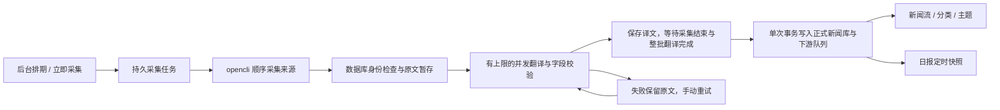

# 内置新闻采集

2026-11-08 起，newsreader 直接执行固定来源采集。应用不再扫描 DailyNews、解析 Markdown／配套 JSON 或调用外部采集 Agent；已有数据库中的新闻 ID、阅读状态和关联资料保持不变。

## 运行与配置

- 启动 `app.py` 或正常启动器后，后台启动排期、采集、翻译协调三个独立工作线程，翻译协调线程管理有上限的翻译线程池及整批入库。关闭网页不影响任务；关闭服务或电脑休眠期间不运行。
- 设置 → 信源与采集可以暂停定时采集、编辑时刻、查看固定来源状态及立即采集。北京时间 `Asia/Shanghai`；每天默认 00:01、04:00、08:00、12:00、18:00、21:00，A 股交易日额外 09:00、10:00、11:00、13:00、14:30。
- 采集与日报共用自动维护的交易日历：平时每周后台检查上交所年度公告；12 月尚未取得下一年时改为每天，取得后恢复每周。缺少当年日历时立即检查，失败后每小时重试；已有当年日历时更新失败沿用当前周期。始终使用已验证的本地日历，不依赖模型或 opencli。缺少对应年份时暂缓交易日额外时刻，常规时刻照常执行。
- 首次启用和修改排期从当前时刻开始；恢复服务时，最近两天错过的时刻合并补采一轮。暂停后恢复不补采暂停期间的任务。已有采集任务时，手动或定时触发合并入当前任务。
- `collection/sources.json` 固定 12 个入口：Reuters 五个栏目、Bloomberg Tech、TechCrunch、Ars Technica，以及 ilyasut、mingchikuo、fxtrader、WaylandZhang 四个 X 账号。首版没有来源配置管理界面；新闻流显示复选框不改变采集任务。
- 沿用本机已安装的 opencli 及 NewsFlow 使用的自定义命令：ReutersBrowser、BloombergUser、TechcrunchPublic、ArsPublic、twitter tweets；X 的备用命令为 twitter user-posts。迁移到新机器时仍须安装这些适配器并准备所需登录会话。应用不自动安装、升级或修改浏览器登录信息。
- 采集字段翻译沿用设置中的翻译 API 路由与 Pi 后备。正文抓取、全文翻译、研究 Agent 和报告模型仍使用各自原有配置。
- API 与 Pi 后备均要求正常完成响应；即使输出可解析为 JSON，截断、中止或没有完成标记的 Pi 结果也不会发布到新闻库。
- 「新闻翻译并发上限」保存为 `collection.translation_concurrency`，默认 4，接受 1–32 的整数。全库同时翻译的请求数受数据库领取检查约束。保存后影响后续领取，降低上限不取消在途请求；仅调整并发不会重置排期或遗漏刚到期的采集。
- macOS 启动器每次分别检测独立 Tailscale 与 Surge 的当前状态和地址；选择顺序为可绑定的客户端地址 → 可接收入站访问的 Surge 节点 → 本机 `127.0.0.1`。发现客户端或 Surge 应用但未运行、地址残留、不可入站时，不会阻止另一种实现被选中。Surge 的用户态地址不能交给 Flask 绑定，使用该路径时监听本机并显示远程访问地址。探测兼容没有 CLI PATH 的 macOS 应用安装，不保存机器 IP、不修改网络配置；显式 `NEWS_READER_HOST` 始终优先。

## 数据流与恢复

`collection_runs` / `collection_run_sources` 保存运行和逐来源结果；`collection_items` 保存原文、已完成译文、尝试次数与发布状态。一次采集运行就是一个入库批次。外部命令和模型调用都在数据库写事务外；SQLite 使用 WAL。采集来源失败时显示来源错误，该来源未采到的内容不计入批次；已采到的新内容必须全部准备完毕。翻译失败暂缓所属批次，不阻塞下一轮采集，也不阻塞其他已就绪批次入库。

翻译完成先保存为 `ready`，不写 `items`，不触发分类或主题任务。只有采集运行结束且无 pending／running／failed 条目时，才在一个事务中写入整批新闻、入库序号和下游队列；分类入队与主题入队每批各调用一次。所有新闻共享实际入库时刻，事务提交前其他连接看不到部分结果。任意写入或入队出错时整批回滚，运行标记 `publication_status=failed`，保留译文供手动重试。空批次也记录完成；已发布和已删除条目不会再次发布。

工作线程以数据库事务领取任务，使用 180 秒租约、每 30 秒续租。重启后接管过期任务；已成功来源不重复执行，已经保存的译文不再次调用模型。命令超时会终止所属进程组；来源限流冷却跨运行保存。人工重试仅重置失败翻译任务，已发布条目不重跑。

正式新闻只在该批需要的翻译全部完成且字段校验成功后发布。译文要求与原文一一对应，不允许缺字段、空译文或截断结束。原文与采集时间保存在任务表，发布时间独立保存并转成北京时间；来源没有有效发布时间时保持未知。已完成的译文在重启和重试后复用；升级前已经逐条发布的历史新闻不撤回，尚未发布的内容按新批次规则完成。

`news_identities` 是唯一采集身份账本，保存规范化 URL 的 SHA-256、对应新闻 ID 和删除标记，覆盖暂存与正式新闻。X URL 统一到帖子 ID，清除 URL 跟踪参数。首次初始化为历史新闻建立映射并保留原 ID；不合并或删除历史重复行。已存在身份再次采到时跳过，标题或采集日期变化不会制造新未读。旧删除指纹在能够重建原「日期 + URL」身份时继续适用；旧版本未保留网址的删除记录无法凭指纹推断另一发布时间的身份。新删除操作保留身份摘要，并清除该来源尚未发布的内容，阻止在途翻译重新发布。

采集错误由顶栏查看；角标计算各来源最后完成结果中尚未恢复的错误，历史记录不因恢复消失。成功但新增 0 条不算故障。入库统计使用实际入库时间点 `ingested_at`，与报道发布日期无关。新闻列上方显示待翻译、翻译中、已完成待整批入库及失败状态；失败提供对应重试，整批入库后才移除提示。

## 阅读与日报边界

- 第一次列表请求取得首次入库序号 `batch`；后续分页、搜索保持相同上界。新入库内容仅更新全局计数，并显示当前筛选范围内的「有 N 条新新闻 · 查看」。点击后重新按发布时间排序，保留原先的阅读状态。
- 列表末尾 5 秒自动已读冻结计时开始时的 ID；加载新批次、切换筛选或离开阅读页面会取消计时。
- 手动全部已读先生成服务端确认快照，有效期 30 分钟，再凭 `preview_id` 提交。未确认的后续入库新闻不会被标读。搜索结果同样冻结已查询的 ID。
- 顶栏通知或任务结束时，若焦点仍在将要收起的区域内，返回「立即采集」；采集中该按钮禁用时返回错误状态入口，避免引用已移除的「刷新索引」。
- 日报取材直接读取当时正式新闻库，不等待采集或翻译。现有用户排期与时间窗口不变，包括已保存的 14:35 午报；14:30 采集未及时完成的新闻不会进入当次快照。报告生成后不会自动重新生成。

仓库附带的 `reports/trading-calendar.json` 是 2026 年保底日历，自动更新保存到当前新闻数据库同目录的 `trading-calendar-cache.json`，重启和升级后继续使用。只接受年度完整公告，完整性与日期校验通过后原子替换缓存；单个节日通知、错误页面、失败响应不会覆盖已验证的年份。跨年会重新检查，下一年尚未公布不作为当前日历错误。未知年份不按普通工作日猜测，界面提示日历未就绪。

日历恢复后，服务运行期间因日历缺失而漏掉的交易日采集合并补采一次；早午报遵守现有运行、休眠及暂停边界，不重复创建已存在的期次。设置 `NEWS_READER_TRADING_CALENDAR_PATH` 时，显式自定义文件为唯一来源，关闭自动更新且不覆盖该文件。详细规则见[交易日历维护](periodic-reports.md#交易日历维护)。

## 接口与迁移

| 接口 | 用途 |
| --- | --- |
| `GET /api/collection` | 排期、下一次执行、最近运行、逐来源状态、翻译队列、发布序号 |
| `POST /api/collection` | 排队一次采集，返回 202 和运行 ID，重复请求合并 |
| `POST /api/collection/retry-translation` | 重试失败翻译／发布，返回 202 |
| `GET /api/news`、`GET /api/search` | 返回 `batch`；分页传同一值；`after_batch` 配合 `count_only=1` 查询新到数量 |
| `POST /api/news/mark-all-read` | `preview:true` 创建确认范围；`preview_id` 提交，不再允许无范围的直接写入 |
| `GET /api/error-stats` | 采集任务记录及实际入库统计 |

`/api/reindex` 和旧 Markdown 日报接口已经移除，`NEWS_READER_DAILY_NEWS_DIR` / `NEWS_READER_DAILY_BRIEFING_DIR` 不再使用。数据库中历史 `source_file` / `source_files` 字段暂时保留以兼容旧库结构，不再用于运行时输入；文章界面不显示文件名。旧格式解析仅留在 `tests/legacy_news_*` 中生成历史回归数据，不属于应用功能。

代码参考 NewsFlowSkills `07cb8a173b17c62699ab0ed2185ca1abdf12b623` 的命令执行、结果规范化和来源重试；没有引入其文件输出、独立去重状态或 Agent 编排。

升级前按现有备份流程备份数据库；启动新版会补建后台任务与身份表。确认新采集正常后停用旧外部采集定时任务。新版不会操作外部 Agent 的自动化配置，也不会删除历史新闻文件。

回退到文件采集版本时，应配套恢复该版本的数据备份，并另外保留新版数据库。旧版的全量索引重建会先清空 `items`，再从 Markdown／JSON 恢复；内置采集的新新闻没有对应文件，不能靠旧版全量重建恢复。不要用该操作修复新版库。

## 验证记录

- v0.5.0 发布检查（2026-11-08）：从 Git 暂存区导出只包含待发布文件的隔离副本，1,639 项后端回归、20 项启动／升级集成回归、72 项 JavaScript 单元测试全部通过；此前因复制完整工作区而未完成的升级、回退及受管进程检查已补齐。界面首轮354／355通过，剩余用例是测试收尾释放请求与异步拦截器之间的竞态；补充等待拦截器结束后，28项手机阅读／采集／批量已读回归及该用例连续3次复测全部通过。未使用真实新闻库制造测试数据。
- 兼容性复查（2026-11-08）：1,574 项后端回归及 42 项启动／升级回归通过；4 项复制完整工作区的旧启动器集成用例未纳入完成结果。正式库备份副本连续迁移两次，30,274 条新闻及阅读状态、正文、想法、高亮、总结、主题、日报记录的内容摘要均保持一致，`quick_check` 正常。
- 浏览器首次全量扫描为 675／708 通过；发现旧刷新按钮残留的焦点异常，以及过时的接口／界面断言和依赖前序用例状态的夹具。修复后针对全部失败项、关联交互及新增焦点用例完成 251 项复测，全部通过，未把首轮全量结果记录为全通过。验证包含稳定阅读批次、5 秒已读、批量确认、采集重试、桌面与手机、各主题，以及采集中按钮禁用时的焦点恢复。
- 采集 Pi 后备现严格检查完成状态；正常完成、截断、中止及缺少完成标记均有独立回归。顶栏 Agent 通知与任务进度已清除旧刷新按钮引用；运行时代码未再引用旧索引／文件日报入口。

- 多机器启动适配：54 项网络发现与启动脚本回归通过，覆盖只使用客户端、只使用 Surge、两者同时存在、两者均不可用、客户端旧地址与不可绑定、Surge 不可入站、探测超时及无 PATH 的应用内 CLI。当前机器实测跳过已停止客户端的保留 IP，识别 Surge 当前地址及入站状态后选择可用入口。

- 整批入库与并发更新：511 项后端／启动回归、28 项浏览器回归通过。覆盖整批可见性、下游单次入队、失败整批回滚、成功译文复用、并发上限动态调整、排期不受并发修改影响，以及 Surge 当前地址发现与独立客户端后备。正式库副本迁移两次后新闻、阅读状态与任务数量不变；已备份正式库并重启，通过健康与排期检查。

- 1502 项后端回归通过（不含未修改的启动器／升级器集成组）；随后针对无发布时间分页补充用例，281 项新闻 API、采集、分类与来源删除回归通过。测试仅使用隔离数据库。
- 69 项浏览器测试通过，覆盖采集设置保存与校验、失败翻译重试、新到提示、稳定分页、末尾 5 秒已读、手动确认期间的新到新闻，以及桌面／触屏手机、浅色／深色／系统／墨水屏主题。
- 启动故障修复后，87 项启动器、采集和手动报告回归通过：Tailscale 保留地址不可绑定时回退到本机；采集线程从应用启动入口启动，无需打开网页或创建日报。已用正常 macOS 启动器验证正式服务健康检查、新闻 API 和采集排期检查均正常。
- 本机 12 个固定 opencli 入口全部成功返回，共 117 条原始候选；实际翻译 API 的单条新闻翻译通过字段校验。这些验证没有发布到正式新闻库。
- 旧格式解析已移至测试夹具，维护测试时通过 `tests/legacy_news_seed.py` 准备历史数据；应用不存在扫描 HTTP 入口。当前工作区已有的带「 2」后缀同步副本未修改，回归使用 Git 跟踪的测试文件列表。
