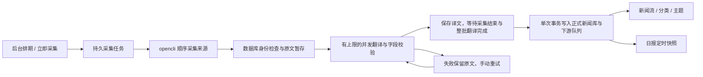

# 内置新闻采集

2026-11-08 起，newsreader 直接执行固定来源采集。应用不再扫描 DailyNews、解析 Markdown／配套 JSON 或调用外部采集 Agent；已有数据库中的新闻 ID、阅读状态和关联资料保持不变。

## 运行与配置

- 启动 `app.py` 或正常启动器后，后台启动排期、采集、翻译协调三个独立工作线程，翻译协调线程管理有上限的翻译线程池及整批入库。关闭网页不影响任务；关闭服务或电脑休眠期间不运行。
- 设置 → 信源与采集可以暂停定时采集、编辑时刻、查看固定来源状态及立即采集。北京时间 `Asia/Shanghai`；每天默认 00:01、04:00、08:00、12:00、18:00、21:00，A 股交易日额外 09:00、10:00、11:00、13:00、14:30。
- 采集与日报共用自动维护的交易日历：平时每周后台检查上交所年度公告；12 月尚未取得下一年时改为每天，取得后恢复每周。缺少当年日历时立即检查，失败后每小时重试；已有当年日历时更新失败沿用当前周期。始终使用已验证的本地日历，不依赖模型或 opencli。缺少对应年份时暂缓交易日额外时刻，常规时刻照常执行。
- 首次启用和修改排期从当前时刻开始；恢复服务时，最近两天错过的时刻合并补采一轮。暂停后恢复不补采暂停期间的任务。已有采集任务时，手动或定时触发合并入当前任务。
- `collection/sources.json` 固定 12 个入口：Reuters 五个栏目、Bloomberg Tech、TechCrunch、Ars Technica，以及 ilyasut、mingchikuo、fxtrader、WaylandZhang 四个 X 账号。首版没有来源配置管理界面；新闻流显示复选框不改变采集任务。
- 项目固定 OpenCLI 2.0.3，并内置 ReutersBrowser、BloombergUser、TechcrunchPublic、ArsPublic 及 Reuters 正文覆盖代码；X 使用固定版本的内置命令。`npm ci --ignore-scripts` 一次安装，不依赖全局 opencli 或个人 adapter。独立 twitter-cli 与旧任务快照中的备用命令均不执行。新机器仍需准备浏览器扩展、登录会话及翻译配置；应用不修改登录信息。
- 采集字段翻译沿用设置中的翻译 API 路由与 Pi 后备。正文抓取、全文翻译、研究 Agent 和报告模型仍使用各自原有配置。
- API 与 Pi 后备均要求正常完成响应；即使输出可解析为 JSON，截断、中止或没有完成标记的 Pi 结果也不会发布到新闻库。
- 「新闻翻译并发上限」保存为 `collection.translation_concurrency`，默认 4，接受 1–32 的整数。全库同时翻译的请求数受数据库领取检查约束。保存后影响后续领取，降低上限不取消在途请求；仅调整并发不会重置排期或遗漏刚到期的采集。
- macOS 启动器每次分别检测独立 Tailscale 与 Surge 的当前状态和地址；选择顺序为可绑定的客户端地址 → 可接收入站访问的 Surge 节点 → 本机 `127.0.0.1`。发现客户端或 Surge 应用但未运行、地址残留、不可入站时，不会阻止另一种实现被选中。Surge 的用户态地址不能交给 Flask 绑定，使用该路径时监听本机并显示远程访问地址。探测兼容没有 CLI PATH 的 macOS 应用安装，不保存机器 IP、不修改网络配置；显式 `NEWS_READER_HOST` 始终优先。

### 采集环境与服务配置

设置 → 信源与采集顶部提供「采集环境」和「采集服务配置」，沿用现有设置卡片、状态反馈、字段和按钮。

- 「检查采集环境」在服务所在电脑运行 项目入口的 `--version`、`--nr-check` 和 `doctor`，确认锁定版本、12 项必需命令、内置源码完整性及 Browser Bridge 连接，不访问新闻页面、不采集入库。手机访问设置时不会检查手机环境。基础检查最长约35秒，重复检查返回忙碌状态。
- 浏览器来源要求服务所在电脑保持 Chrome / Chromium 运行，在相同浏览器配置中安装、启用 OpenCLI Browser Bridge 扩展。扩展未连接不能直接推断未安装。公开 RSS 不依赖浏览器；浏览器失败不阻止其他来源尝试采集。
- 「检查 X 登录」按需执行只读 `opencli twitter whoami`，会访问 X，最长约60秒。仅根据有效身份响应确认已登录；超时、网络异常或不支持此命令时标记未确认，不冒充未登录。不会自动登录、修改会话或保存／返回用户名、Cookie 和命令原始输出。重新检查浏览器后，界面上的旧 X 登录结果失效。
- Bypass Paywalls Clean 是可选、由用户手动安装的 Chrome 扩展；设置提供项目安装说明，不将它设为全来源前置条件，也不声称已自动检测安装或生效。应另外验证目标文章是否可完整读取。
- 「采集服务配置」显示已保存的翻译调用顺序、模型及缺少的密钥／模型，并跳转现有 API 管理或模型与 Agent。Pi 后备仍使用已保存的 Chat Pi 配置。配置齐全不代表连接成功，沿用对应服务的连接测试，不重复维护密钥。
- 检查仅由按钮发起；结果附检查时间，失败保留上次结果并提示时效。切换设置、运行检查不会覆盖未保存草稿，也不改变采集排期。

### 采集依赖的集成与发布约定

项目内集成已实现，安装、加载隔离、升级与完整验收命令见 [OpenCLI 集成说明](opencli-integration.md)。以下约定持续适用于后续发布：

1. opencli 采用项目内 npm 精确版本和锁文件，自定义 adapter 源码记录来源提交、随 NewsReader 发布。插件（plugin）只负责组织和加载 adapter，不获得独立自动升级权限。项目入口显式加载锁定模块，不注册用户级 plugin、不扫描个人目录；浏览器扩展独立配置。
2. 每次准备发布／推送 NewsReader 前，检查 opencli 上游稳定版本。发现新版先建立候选依赖；检查不等于升级。仅在全部验收通过后更新锁定版本。失败、未测或缺少浏览器账号环境时保留已验证旧版，不自动追随 latest。记录上游版本、检查日期、采用／暂缓原因。
3. 候选版本必须运行所有自定义 adapter 的自动化测试及真实来源验证，覆盖固定12个采集入口、Reuters 自定义正文、TechCrunch／Ars 正文，以及使用的内置 Bloomberg 正文、X 列表／线程／长文命令。检查范围同时包含共享辅助代码，不能仅以 `--help`、进程退出码或返回 JSON 作为通过条件。
4. 验证数据契约：列表的标题、合法来源 URL、来源归属、条数／时间字段格式；X 帖子身份、原文、转引与媒体；正文需属于目标文章、有实质内容，排除登录页、验证页、付费墙提示和导航文本。允许来源确实未提供的时间按当前规则保持未知；不能把无可见评论误判为空线程。维护近期样本和代表性长文、列表式正文等边界样本。不得因上游更新直接降低验收阈值。
5. 在无全局 opencli、无既有自定义 adapter 的干净环境验证安装与加载，并检查超时、限流、登录过期、缺依赖、去重和暂存入库回归。实际来源验证使用独立数据目录，不向真实新闻库写测试内容。无法执行的项目标为未验证，不能计入通过。
6. 发布记录同时包含 NewsReader、opencli、adapter 来源提交、测试过的浏览器扩展版本与测试结果。Chrome 扩展属于独立更新组件，运行时仍需兼容性检查。NewsReader 升级器连同锁定依赖和 adapter 更新／回退，依赖准备失败时保留原可运行版本；不能只回退 Git 源码而留下新依赖。

上游参考：[OpenCLI 安装与浏览器扩展](https://github.com/jackwener/OpenCLI#quick-start)、[adapter 与 plugin](https://github.com/jackwener/OpenCLI/blob/main/docs/guide/extending-opencli.md)、[Bypass Paywalls Clean](https://gitflic.ru/project/magnolia1234/bypass-paywalls-chrome-clean)。

## 数据流与恢复

`collection_runs` / `collection_run_sources` 保存运行和逐来源结果；`collection_items` 保存原文、已完成译文、尝试次数与发布状态。一次采集运行就是一个入库批次。外部命令和模型调用都在数据库写事务外；SQLite 使用 WAL。采集来源失败时显示来源错误，该来源未采到的内容不计入批次；已采到的新内容必须全部准备完毕。翻译失败暂缓所属批次，不阻塞下一轮采集，也不阻塞其他已就绪批次入库。

翻译完成先保存为 `ready`，不写 `items`，不触发分类或主题任务。只有采集运行结束且无 pending／running／failed 条目时，才在一个事务中写入整批新闻、入库序号和下游队列；分类入队与主题入队每批各调用一次。所有新闻共享实际入库时刻，事务提交前其他连接看不到部分结果。任意写入或入队出错时整批回滚，运行标记 `publication_status=failed`，保留译文供手动重试。空批次也记录完成；已发布和已删除条目不会再次发布。

工作线程以数据库事务领取任务，使用 180 秒租约、每 30 秒续租。重启后接管过期任务；已成功来源不重复执行，已经保存的译文不再次调用模型。命令超时会终止所属进程组；来源限流冷却跨运行保存。人工重试只重置所选范围的失败翻译任务或失败发布批次，不重新采集，已发布条目不重跑。

正式新闻只在该批需要的翻译全部完成且字段校验成功后发布。译文要求与原文一一对应，不允许缺字段、空译文或截断结束。原文与采集时间保存在任务表，发布时间独立保存并转成北京时间；来源没有有效发布时间时保持未知。已完成的译文在重启和重试后复用；升级前已经逐条发布的历史新闻不撤回，尚未发布的内容按新批次规则完成。

`news_identities` 是采集去重账本，保存规范化 URL 的 SHA-256、新闻 ID 和删除标记，覆盖已入库、待翻译、翻译失败及已删除新闻。新 URL 的新闻 ID 为 `SHA-256(规范化 URL)`；同一 URL 无论栏目、原文标题、中文译名、摘要、发布时间或采集日期如何变化，均在翻译前跳过。不同 URL 即使标题相同也独立收录。URL 规范化沿用原实现，包括清除跟踪参数；X 继续按帖子 ID 去重。来源、栏目、账号、每次采集条数和发布时间窗口不变。

标题变化不能可靠地证明报道有新进展，因此停止 v0.5.2 的标题版本新增策略，不再产生「更新」标签或因标题变化清除当前正文缓存。采集记录继续分别统计抓取、去重、过滤和实际入库数量。

`news_identity.py` 集中维护与 v0.5.1 一致的 URL 规范化与身份哈希；采集的空标题过滤也沿用 v0.5.1。标题规范化仅保留在测试夹具中，用于重建旧 ID，不进入实际采集流程。`news_versions.py` 只负责旧标题记录的兼容读取和重复任务处理。

### 标题版本与旧库兼容

- 不重算或替换已有 `items.id`，URL 哈希 ID、更早的「日期＋URL」ID 和 v0.5.2 的「URL＋标题」ID 都原样保留。URL 身份账本映射到这些旧 ID 后，后续重遇直接去重，不再要求原文标题回填或首次重遇基准。
- 已入库的同链接条目不自动删除或合并，保留原有浏览／全文阅读状态、收藏、想法、划线、报告引用和正文快照。旧标题索引及缓存表仅供读取既有记录，不再创建新的标题版本。
- 启动时通过旧标题索引筛选 v0.5.2 尚未入库的任务，不对普通 URL 任务逐条执行兼容查询。同 URL 已有正式新闻，或该任务不是 URL 身份账本中的原始任务时，结束为 `duplicate` 并释放租约；待翻译、在途翻译、就绪和失败任务均适用，不重复调用模型。该 URL 还未有正式新闻时，保留原始任务及其旧 ID，正常完成或重试。
- 发布前再次校验 URL 身份；重复任务不能绕过启动检查入库。重复任务只计一次去重，减少该批待新增数，不增加入库数；旧去重总数未知时继续保持未知。空批次正常结束，其他 URL 的任务继续按整批机制入库；迟到的旧翻译结果因租约失效而丢弃。
- 重复启动不会再次累计去重数；信源清理仍会清除已结束的重复任务与旧快照，并保留 URL 删除身份，阻止改题重新纳入已删除新闻。

### 已保存正文的兼容读取

v0.5.2 已保存的 `news_version_snapshots`、标题索引和 `news_article_heads` 保留，读取时仍按条目 ID 区分保存的旧正文／译文和当前 URL 缓存，覆盖阅读器、列表、划线、Agent、总结、日报及来源引用。恢复 URL 去重不重置现有缓存，也不会因为再次采到不同标题而触发抓取／翻译。

历史条目已有的正文保持可读；未保存历史正文的空快照不会借用当前正文，也不会从当前网页补写。界面移除「更新」标签和「发现更新」时间，保留「此前收录／同链接新闻」入口以访问已有条目，不据此判断媒体报道的进展。没有历史正文的旧待阅读标记仍可主动移除。URL 级想法及其关联继续保留。

历史条目的接口元数据只提供正文归档状态及导航所需的条目 ID，不再下发 `is_update / update_detected_at / original_item_id / baseline_only`；旧数据库中的这些字段保持原样。

顶栏「采集记录」按北京时间展示每日汇总。每次采集运行作为一个批次，以采集开始时间为卡片标题，从新到旧排列；同批来源数量合并汇总，来源明细默认折叠，可展开查看逐来源结果。不同运行即使开始于同一秒也不会合并。可切换日期，通过「全部信息／仅错误与提示」筛选；后台刷新保留当前筛选与来源展开状态。

**错误**是采集阶段的问题，例如来源连接失败。该次结果不可原地修复，保留原因及「等待下次采集」，可复制错误信息。**提示**是采集后、正式入库前的可修复问题：翻译失败旁提供「重试翻译」，只重试该批该来源的失败新闻；整批入库失败旁提供「重试入库」，只重试该批，复用已有译文。同批入库失败提示只展示一次；修复后提示消失，历史采集错误保留。「仅错误与提示」保留含这些问题的完整批次；正常等待、采集中、成功、无新增、内容过滤及旧计数缺失均仅在「全部信息」中显示，不视为提示。四项统计始终覆盖完整所选日期，口径如下：

- **抓取**：各来源返回的规范化新闻候选条数，包含重复内容，按来源开始采集日归属。
- **去重**：身份账本中已存在的候选（含待翻译、已入库、已删除内容），不混入空标题、视频等过滤内容。过滤数量在记录中另列；旧版未独立保存去重数且无法可靠还原时显示「未记录」。混合新旧记录的汇总仅在已知去重数大于 0 时显示「≥ N 条」，否则仍显示「未记录」，不使用缺乏信息的「≥ 0 条」；完整的新记录按实际数量显示，确实没有重复时为「0 条」。
- **纳入数据库**：正式新闻表实际新增成功的条数，待翻译或 ready 均不计入。按实际入库日统计；跨日入库在完成当日另列记录，原采集日不重复计数。计数与整批入库在同一事务提交，失败回滚不增加；记录独立保存，之后删除新闻不减少已保存的历史数量。
- **错误**：失败的来源采集记录数，同一来源多次失败分别计数并保留错误信息；不是失败新闻条数。翻译和整批入库失败属于提示，不增加错误计数，既可在批次卡片旁按范围重试，也可沿用新闻列的失败重试入口。

角标计算各来源最后完成结果中尚未恢复的错误，独立于所选历史日期；来源恢复不删除历史错误。成功但新增 0 条不算故障。新闻列上方显示待翻译、翻译中、已完成待整批入库及失败状态；失败提供对应重试，整批入库后才移除提示。

## 阅读与日报边界

- 第一次列表请求取得首次入库序号 `batch`；后续分页、搜索保持相同上界。新入库内容仅更新全局计数，并显示当前筛选范围内的「有 N 条新新闻 · 查看」。点击后重新按发布时间排序，保留原先的阅读状态。
- 列表末尾 5 秒自动已读冻结计时开始时的 ID；加载新批次、切换筛选或离开阅读页面会取消计时。
- 手动全部已读先生成服务端确认快照，有效期 30 分钟，再凭 `preview_id` 提交。未确认的后续入库新闻不会被标读。搜索结果同样冻结已查询的 ID。
- 顶栏通知或任务结束时，若焦点仍在将要收起的区域内，返回「立即采集」；采集中该按钮禁用时返回错误状态入口，避免引用已移除的「刷新索引」。
- 日报取材直接读取当时正式新闻库，不等待采集或翻译。现有用户排期与时间窗口不变，包括已保存的 14:35 午报；14:30 采集未及时完成的新闻不会进入当次快照。报告生成后不会自动重新生成。

仓库附带的 `reports/trading-calendar.json` 是 2026 年保底日历，自动更新保存到当前新闻数据库同目录的 `trading-calendar-cache.json`，重启和升级后继续使用。只接受年度完整公告，完整性与日期校验通过后原子替换缓存；单个节日通知、错误页面、失败响应不会覆盖已验证的年份。跨年会重新检查，下一年尚未公布不作为当前日历错误。未知年份不按普通工作日猜测，界面提示日历未就绪。

日历恢复后，服务运行期间因日历缺失而漏掉的交易日采集合并补采一次；早午报遵守现有运行、休眠及暂停边界，不重复创建已存在的期次。设置 `NEWS_READER_TRADING_CALENDAR_PATH` 时，显式自定义文件为唯一来源，关闭自动更新且不覆盖该文件。详细规则见[交易日历维护](periodic-reports.md#交易日历维护)。

## 接口与迁移

| 接口 | 用途 |
| --- | --- |
| `GET /api/collection` | 排期、下一次执行、最近运行、逐来源状态、翻译队列、发布序号 |
| `POST /api/collection` | 排队一次采集，返回 202 和运行 ID，重复请求合并 |
| `POST /api/collection/environment/check` | `{target:"environment"}` 检查命令与浏览器，`{target:"x"}` 检查 X 登录；无请求体时默认 environment。返回脱敏检查项和检查时间；参数错误400、已有检查409，不写新闻库 |
| `POST /api/collection/retry-translation` | 无请求体时重试全部失败翻译／发布；`{run_id, source_id, stage:"translation"}` 只重试本批本来源，`{run_id, stage:"publication"}` 只重试本批入库；返回 202 与 `retried` 数量，参数无效返回 400，目标不存在返回 404 |
| `GET /api/news`、`GET /api/search` | 返回 `batch`；分页传同一值；`after_batch` 配合 `count_only=1` 查询新到数量 |
| `POST /api/news/mark-all-read` | `preview:true` 创建确认范围；`preview_id` 提交，不再允许无范围的直接写入 |
| `GET /api/error-stats` | `day=YYYY-MM-DD` 查询每日采集记录与四项统计；`details=0` 仅返回日期与当前未恢复来源数 |

`/api/reindex` 和旧 Markdown 日报接口已经移除，`NEWS_READER_DAILY_NEWS_DIR` / `NEWS_READER_DAILY_BRIEFING_DIR` 不再使用。数据库中历史 `source_file` / `source_files` 字段暂时保留以兼容旧库结构，不再用于运行时输入；文章界面不显示文件名。旧格式解析仅留在 `tests/legacy_news_*` 中生成历史回归数据，不属于应用功能。

代码参考 NewsFlowSkills `07cb8a173b17c62699ab0ed2185ca1abdf12b623` 的命令执行、结果规范化和来源重试；没有引入其文件输出、独立去重状态或 Agent 编排。

升级前按现有备份流程备份数据库；启动新版会补建后台任务与身份表。确认新采集正常后停用旧外部采集定时任务。新版不会操作外部 Agent 的自动化配置，也不会删除历史新闻文件。

v0.5.1 在 `collection_run_sources` 增加独立去重／过滤计数及持久入库数量／时间。迁移仅从仍保留的采集条目回填已知入库事实，不重建已删除的历史任务，不修改已有新闻内容、身份或阅读状态；重复初始化不会重复累计。`/api/error-stats` 新增完整 `records`，每条包含批次 `run_id`、`batch_started_at` 及当前失败的 `notices`（翻译／发布阶段、错误和适用的条数），保留原有 `days` 失败记录与可用率字段供旧客户端兼容。

回退到文件采集版本时，应配套恢复该版本的数据备份，并另外保留新版数据库。旧版的全量索引重建会先清空 `items`，再从 Markdown／JSON 恢复；内置采集的新新闻没有对应文件，不能靠旧版全量重建恢复。不要用该操作修复新版库。

## 验证记录

- 2026-11-10 采集环境与 X 单通道（未发布）：27项环境诊断用例及107项采集／正文／Token相关回归通过；42项界面相关用例完成验证，覆盖桌面／手机、浅色／深色／系统浅深／墨水屏及四档阅读字号。首轮界面31／42通过，帮助页11项失败在改动前代码同样复现，原因是新增去重问答后旧键盘顺序断言未更新；修正后帮助页15项复测全部通过。已复核新分区截图及现有设置样式一致性。本机实际验证 opencli 2.0.3、Browser Bridge 1.0.27 连接与 X 登录检查成功，未保存账号信息或向正式新闻库写测试数据。没有升级 opencli 或宣称全部 adapter 已通过新版本验收。

- v0.5.1（2026-11-09）：76项后端／兼容性／Token／版本回归与87项浏览器回归通过，覆盖同批来源合并、不同批次隔离、错误与提示区分、按来源／批次重试、成功译文复用、展开与焦点保持、成功、零新增、失败、去重、整批回滚、跨日入库、删除后的历史计数、旧库迁移，以及桌面／触屏手机、浅色／深色／系统浅深／墨水屏和四档阅读字号。现有数据库只读备份副本连续迁移两次，58张已有表的原有字段摘要均保持一致，30,286条新闻内容及关联状态未变化，`quick_check` 正常；正式库未写入测试状态。
- v0.5.0 发布检查（2026-11-08）：从 Git 暂存区导出只包含待发布文件的隔离副本，1,639 项后端回归、20 项启动／升级集成回归、72 项 JavaScript 单元测试全部通过；此前因复制完整工作区而未完成的升级、回退及受管进程检查已补齐。界面首轮354／355通过，剩余用例是测试收尾释放请求与异步拦截器之间的竞态；补充等待拦截器结束后，28项手机阅读／采集／批量已读回归及该用例连续3次复测全部通过。未使用真实新闻库制造测试数据。
- 兼容性复查（2026-11-08）：1,574 项后端回归及 42 项启动／升级回归通过；4 项复制完整工作区的旧启动器集成用例未纳入完成结果。正式库备份副本连续迁移两次，30,274 条新闻及阅读状态、正文、想法、高亮、总结、主题、日报记录的内容摘要均保持一致，`quick_check` 正常。
- 浏览器首次全量扫描为 675／708 通过；发现旧刷新按钮残留的焦点异常，以及过时的接口／界面断言和依赖前序用例状态的夹具。修复后针对全部失败项、关联交互及新增焦点用例完成 251 项复测，全部通过，未把首轮全量结果记录为全通过。验证包含稳定阅读批次、5 秒已读、批量确认、采集重试、桌面与手机、各主题，以及采集中按钮禁用时的焦点恢复。
- 采集 Pi 后备现严格检查完成状态；正常完成、截断、中止及缺少完成标记均有独立回归。顶栏 Agent 通知与任务进度已清除旧刷新按钮引用；运行时代码未再引用旧索引／文件日报入口。

- 多机器启动适配：54 项网络发现与启动脚本回归通过，覆盖只使用客户端、只使用 Surge、两者同时存在、两者均不可用、客户端旧地址与不可绑定、Surge 不可入站、探测超时及无 PATH 的应用内 CLI。当前机器实测跳过已停止客户端的保留 IP，识别 Surge 当前地址及入站状态后选择可用入口。

- 整批入库与并发更新：511 项后端／启动回归、28 项浏览器回归通过。覆盖整批可见性、下游单次入队、失败整批回滚、成功译文复用、并发上限动态调整、排期不受并发修改影响，以及 Surge 当前地址发现与独立客户端后备。正式库副本迁移两次后新闻、阅读状态与任务数量不变；已备份正式库并重启，通过健康与排期检查。

- 1502 项后端回归通过（不含未修改的启动器／升级器集成组）；随后针对无发布时间分页补充用例，281 项新闻 API、采集、分类与来源删除回归通过。测试仅使用隔离数据库。
- 69 项浏览器测试通过，覆盖采集设置保存与校验、失败翻译重试、新到提示、稳定分页、末尾 5 秒已读、手动确认期间的新到新闻，以及桌面／触屏手机、浅色／深色／系统／墨水屏主题。
- 启动故障修复后，87 项启动器、采集和手动报告回归通过：Tailscale 保留地址不可绑定时回退到本机；采集线程从应用启动入口启动，无需打开网页或创建日报。已用正常 macOS 启动器验证正式服务健康检查、新闻 API 和采集排期检查均正常。
- 本机 12 个固定 opencli 入口全部成功返回，共 117 条原始候选；实际翻译 API 的单条新闻翻译通过字段校验。这些验证没有发布到正式新闻库。
- 旧格式解析已移至测试夹具，维护测试时通过 `tests/legacy_news_seed.py` 准备历史数据；应用不存在扫描 HTTP 入口。当前工作区已有的带「 2」后缀同步副本未修改，回归使用 Git 跟踪的测试文件列表。

恢复 URL 去重验证（2026-11-09，v0.5.3）：566 项相关 Python 回归、14 项前端组件测试和 39 项浏览器回归通过。覆盖跨栏目／改题／改时间去重、URL 哈希 ID、原任务失败后重试、旧库 ID 和正文保留、重复任务退役及租约失效、新旧任务混合启动、废弃更新字段移除、计数幂等、事务回滚、删除后不复活；界面覆盖桌面、手机、浅／深／系统浅深／墨水屏与四档阅读字号。正式库只读备份副本连续初始化两次，62 张已有表的内容摘要均未改变，30,361 条新闻及 29,306 条状态记录保持一致，`quick_check=ok`。测试未写入正式库，也未调用真实信源或模型。

启动兼容检查的合成基准（SQLite 内存数据库、普通 URL 待处理任务）：1,000 条任务的初始化 SQL 从 3,020 次降为 20 次，10,000 条从 30,020 次降为 20 次；对应五次运行中位耗时约 7.7→0.08ms、79.4→0.49ms。这些结果仅衡量该合成库的采集初始化，不代表整个应用的启动耗时。

历史记录：v0.5.2 标题版本验证（2026-11-09）累计 708 项相关 Python 回归、8 项前端组件测试和 76 项浏览器回归通过。覆盖原文标题与译文独立、格式差异去重、A→B→A、推文去重不变、旧 ID 回填／首次重遇基准、历史重复行、正文与译文快照、晚入库及在途任务失效、事务回滚、删除后的版本不复活，以及阅读器、主题和报告来源引用；界面覆盖桌面、手机、1024／1280px 边界、浅／深／系统浅深／墨水屏与四档阅读字号。正式库只读备份副本连续迁移两次，58 张已有表的原有字段摘要均未改变，30,286 条新闻及 29,283 条状态记录保持一致，`quick_check=ok`；测试未写入正式库，也未调用真实信源或模型。
